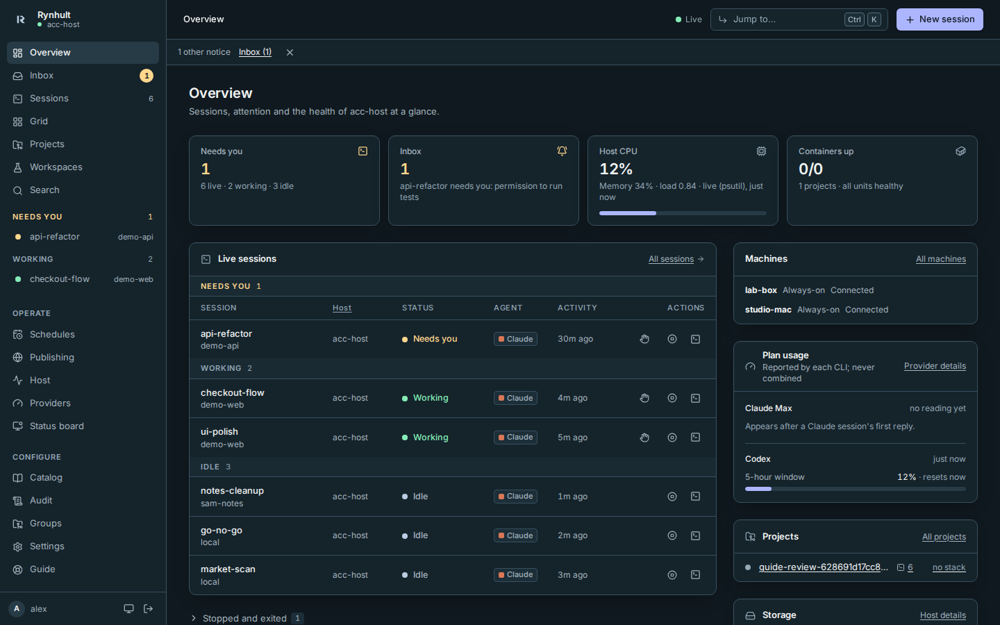
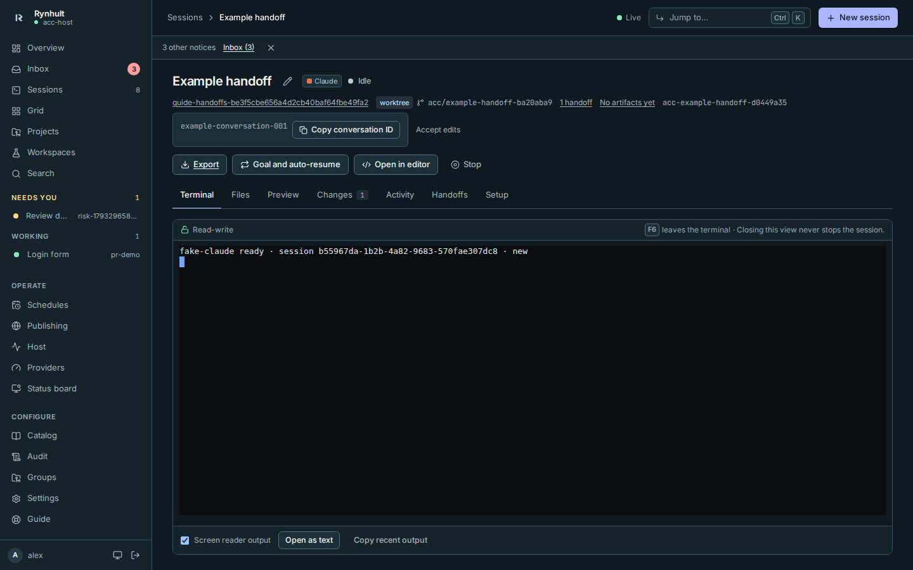
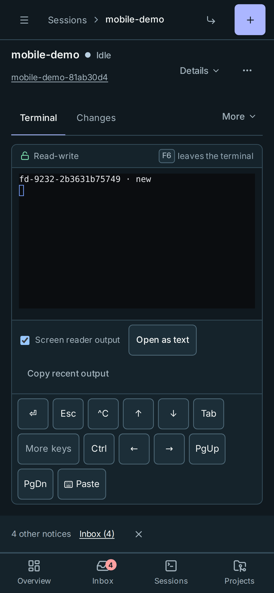

# Rynhult

The next planned public release is **v0.15.0-rc.1**, after the feature freeze
(approximately November 9-13, 2026), together with `rynhult/rynhult` and
`rynhult.dev`. Publication still needs a reviewed snapshot and explicit owner
approval; clone and release URLs below describe the future release route.
No public repository, npm CLI package or Docker image is promised available yet.

**v1.0 scope:** the self-hosted Linux server, used from a browser on any client
platform, including the phone web app. Existing Linux, macOS and Windows-through-WSL
nodes remain supported. Native apps follow v1.0, one platform at a time; the order
is not chosen yet. Existing desktop/mobile source
is experimental, not part of the v1 application release. See
[the scope decision](docs/decisions/0073-v1-linux-server-scope.md).

Rynhult (spoken **RIN-hult**, formerly ACC) is the product name.

**Version 0.15.0-rc.1** · [Changelog](CHANGELOG.md) · [User guide](docs/wiki/User-Guide.md) · [Internals](docs/wiki/Internal.md)

> **Release candidate.** This is preparation for the first public Linux-server RC, not a stable release or a publication announcement. Use a machine you can restore, and read the [release notes](docs/release-notes/0.15.0-rc.1.md) for installation, upgrade and known issues.

Rynhult is a self-hosted dashboard for running and supervising **native** coding-agent CLI sessions (Claude Code, Codex, GitHub Copilot CLI, Google Antigravity CLI, Cursor CLI, OpenCode) on your own Linux machine, and optionally on other machines you add. You choose the agent, its profile and the work. Rynhult starts it in a real terminal (tmux), keeps it running across disconnects and reboots, tells you when it needs you, and keeps every project's code, wiki and deployments in one place.



## What it does

- **Real CLI sessions, in your browser.** Each session is the actual agent CLI in tmux. Its page embeds that terminal (desktop and phone), with one writer at a time and nothing lost when you close the tab.
- **Supervision first.** People decide what runs. Rynhult tracks each session's state from the CLIs' own hooks (grouped into Needs you, Working and Idle, with what each is doing now), resumes the same conversation after a crash or reboot, and puts everything that needs you in one inbox, with push notifications to your phone.
- **Optional, bounded helpers.** You can give one session the **Orchestrator** role: it may start helper agents only within the limits you grant (how many at once and in total, how deep, which agents and profiles, which machines, for how long), and you merge its single pull request yourself. It is off unless you choose it, and **Stop team** stops every helper.
- **More than one run.** **Several agents** runs the same task independently on 2 to 5 agent/model combinations to compare and keep the best. **Schedules** start ordinary sessions at times you choose (new schedules start paused). A session can have a bounded **goal** and **resume when its plan limit resets**; all of these are off by default.
- **See the work.** Each session's **Changes** (a diff of everything it changed since it started, with comments on lines sent back to the agent), **Artifacts** (screenshots, recordings, logs and reports it left for you), a **Grid** of up to four live terminals, and **Search** across every conversation, archived ones included. Start a session straight from a GitHub issue or pull request.
- **Parallel agents, safely.** Sessions can run in their own git **worktree** and branch. **Guardrails** (no force pushes, no pushes to main, no deletes outside the workspace, no reading secrets, plus your own patterns) apply in every permission mode. They're a safety net against mistakes and casual prompt injection, not a sandbox: use branch protection, separate agent accounts and backups for real protection. Optional, personal **usage budgets** warn you or pause new launches; none are set unless you set them.
- **Projects and workspaces.** Start a project from the browser: an empty folder, a clone of any repository your agent account can reach, or a new GitHub repository; Rynhult makes the folder and trusts it in the same step, no server shell needed. Existing folders can be registered too. Each project shows its sessions, CI, pull requests, issues, Docker stack and reserved ports. Research happens in local workspaces you can promote to projects.
- **Profiles and a vetted catalog.** Profiles bundle skills, subagents and MCP servers per role (Frontend, Backend, Researcher…). Imports are checked for risky content, and MCP servers are installed from a lockfile, never fetched at launch.
- **Wikis.** Every project's `docs/wiki` is rendered in the dashboard, and Rynhult's own documentation is built in (the **Guide** tab).
- **Publishing.** Put a project on a hostname: Rynhult writes the Caddy site and the Cloudflare DNS record and checks HTTPS. Agents can only ask; a person approves.
- **Several people.** Owners invite members with a one-time link. Each person's agents run as their own unprivileged Linux account with their own agent and GitHub logins, and see only their own work. **Groups** add maintainers, private same-host Git exchange of committed work, a shared work board and group sessions launched in private checkouts on the main.
- **Containers per session (Preview).** An owner can run a project's new sessions each in its own rootless container,
  with per-account limits. It's off by default, switched on per project, and only on a host that has passed the
  container qualification ([docs/CONTAINERS.md](docs/CONTAINERS.md)).
- **Several machines.** Add a Linux server, a Windows PC (through WSL2) or a Mac under **Host → Machines**: it connects out to this Rynhult with a signed link, and projects on it run their sessions there, in the same dashboard. People still choose where each session runs.
- **Host health.** CPU, memory, disks and SMART, GPU, services, containers and each agent account's usage, detected on whatever machine Rynhult runs on, first on the Host page.
- **Backups.** The installer's daily backup of Rynhult's state, and on **Host → Backups** encrypted, verified backups (restic) to an enrolled Linux machine, S3-compatible storage or a directory an administrator provisions, with a recovery kit you keep offline.

| Session terminal | On a phone |
|---|---|
|  |  |

A screenshot tour of every feature is in [Every feature at a glance](docs/wiki/User-Guide/Features.md).

## Requirements

- **Linux with systemd and apt:** Ubuntu 24.04 or newer, or Debian 13 or newer (Python 3.12+), on amd64 or arm64. Any hardware: disks, GPUs (NVIDIA, via `nvidia-smi`, when present) and network addresses are detected at run time.
- **A regular Linux user** who owns Rynhult's projects (the "owner"). Rynhult creates an unprivileged `<owner>-agent` account for that person's agent sessions, plus one more account for each person you invite.
- **Subscriptions or API access** for the CLIs you use (any of Claude Code, Codex, GitHub Copilot CLI, Antigravity, Cursor; OpenCode also takes API keys from the vault or a local model). Setup installs the ones you pick and keeps them updated; you sign each agent account in from the dashboard.
- **Network:** Rynhult is reachable from private addresses only (LAN, VPN or Tailscale) and serves HTTPS through Caddy. Every device needs to find Rynhult's name: a DNS entry on your router or local DNS, a Tailscale MagicDNS name, or a Cloudflare zone (hosts-file entries work for computers, not phones). See [No DNS server?](docs/wiki/User-Guide/Install.md#no-dns-server) and [Connect your phone](docs/wiki/User-Guide/Connect-Your-Phone.md).
- **Optional, a domain on Cloudflare:** for a trusted certificate (one wildcard via DNS-01, so your hostnames stay out of Certificate Transparency logs) and for publishing project sites. Without one, Caddy signs Rynhult's certificate with its own local authority.

## Install

For a published source release, download its archive, `BUILD`, `SHA256SUMS` and
`SHA256SUMS.asc` from the release page. Download the public key and inspect it:

```sh
curl --fail --show-error --location --output rynhult-release-key.asc \
  https://rynhult.dev/keys/rynhult-release-key.asc
gpg --show-keys --with-subkey-fingerprint rynhult-release-key.asc
```

Compare these **full fingerprints** with an independently trusted copy before
importing; stop if they differ:

- Primary: `0C2C E126 57BD 833F B5B5 63B2 B555 F6E1 2799 0DB5`.
- Signing subkey: `B072 4912 051F F1F2 74CD EE7F EDE4 F41B 077B D2A7`.

In the release folder, verify the signature **before** checking the downloads:

```sh
gpg --import rynhult-release-key.asc
gpg --verify SHA256SUMS.asc SHA256SUMS && sha256sum -c SHA256SUMS
```

Stop if either check fails or the signature is missing. On macOS the checksum
command is `shasum -a 256 -c SHA256SUMS`. Only `SHA256SUMS` is signed; it
authenticates hashes of the listed files, not a Git clone or release tag.
**The in-app updater does not verify signatures yet.** See
[release verification and its limits](SECURITY.md#verify-a-source-release).
The alternative Git source-install route below does not perform that verification:

```bash
git clone https://github.com/rynhult/rynhult acc
sudo acc/deploy/acc-install
```

`acc-install` asks whether this machine is the **main Rynhult** or an **additional machine** for an existing one (for that, paste the command from **Host → Machines → Add machine**; on a new Linux machine that command alone installs everything). The user guide's Install page covers Windows and macOS too.

For the main Rynhult it runs `deploy/setup.sh`, which you can also run directly. `setup.sh` asks a few questions: the owner, a Cloudflare zone (optional), the name to open Rynhult at, and this machine's addresses. Then it:

1. installs the dependencies: git, tmux, Python 3.12+, [uv](https://docs.astral.sh/uv/), Node.js 22+, the GitHub CLI, Caddy, Claude Code (from Anthropic's signed apt repository, key fingerprint checked), and rootless Docker for the owner;
2. copies the checkout to `/srv/acc/app` (Rynhult's units run from there);
3. writes this machine's settings to `/etc/default/accd`;
4. runs `deploy/install.sh`, which creates Rynhult's users and folders, builds the UI, installs Codex (at Rynhult's catalog pin) and the MCP servers (from the lockfile), and starts the services.

At the end it prints the next steps: a DNS entry for Rynhult's name, the one-time setup token for the first sign-in, and signing the agent account in to Claude, Codex and GitHub. After that, everything happens in the browser: the Overview's **Get started** list walks through signing in an agent, making a first project (no shell needed) and starting a session, and a one-line banner points to connecting your phone.

**Unattended:** set the answers in the environment and pass `--yes`:

```bash
sudo ACC_OWNER=alex ACC_ZONE=example.com CF_API_TOKEN=… ACC_CADDY_SHA256=<approved-hash> ACC_INTERNAL_IP=10.0.0.20 acc/deploy/setup.sh --yes
```

`sudo acc/deploy/setup.sh --help` lists every variable.

**Update Rynhult:**

```bash
sudo git -C /srv/acc/app pull && sudo /srv/acc/app/deploy/install.sh
```

The agent CLIs and Ollama are installed and kept up to date by Rynhult itself: owners use **Providers → Agent software** (install, update, remove, auto-update), and a daily check reports versions. Codex and Copilot use Rynhult catalog pins; OpenCode stays on its supported line. Rolling upstream automatic updates require owner opt-in (see docs/PROVIDERS.md).

**Firewall:** setup doesn't change it. Allow 80 and 443 to Caddy, and keep project ports (8000–8199) to your LAN.

## Configuration

Everything machine-specific is in `/etc/default/accd`. `deploy/accd.env.example` documents each setting; restart `accd` after changes. Secrets never go in git:

| Secret | Where |
|---|---|
| GitHub token for repository views and creation (optional) | `/srv/acc/data/secrets/github_token` (acc, 0600) |
| Cloudflare token (DNS for Rynhult and published sites) | `/etc/caddy/cloudflare.env` and `/srv/acc/data/secrets/cloudflare_token` |
| Each agent account's Claude, Codex and GitHub logins | that account's home, set from the dashboard's Providers page |

**Backups.** Two kinds, both owner-run:
- **Daily** (set up by the installer): Rynhult's state to `/var/backups/acc`, kept 14 days. `/etc/default/acc-backup` can add mirrors of folders your projects dump to (`ACC_BACKUP_MIRRORS="user:/source:/dest"`).
- **Encrypted** (**Host → Backups**): restic captures of Rynhult's control state to an enrolled Linux machine, S3-compatible storage or a directory an administrator provisions. Targets default to a daily capture and a weekly full restore check (hourly can be chosen), keeping 48 hourly, 30 daily and 12 monthly copies. They start off; an owner exports the recovery kit first. See the Guide's [Backups](docs/wiki/User-Guide/Backups.md).

## How it's built

- **accd:** a FastAPI service with SQLite, running as the unprivileged `acc` user. It listens on a Unix socket only Caddy can reach.
- **One broker per agent account:** small root-free daemons that run tmux, the CLIs and terminal attaches as that account. accd never runs agent code itself.
- **rynhult-node** (optional, on other machines): relays this Rynhult's broker connections over one outbound, signed WebSocket, so a machine needs no open port (`docs/MULTIHOST.md`).
- **Root helpers, each sandboxed:** they publish sites, create agent accounts, install and update agent software, take the host snapshot and run backups. accd hands them validated requests through files and can't run anything else as root.
- **Web UI:** React and Vite, with xterm.js for terminals. It can be installed as an app on phones and desktops.

Details: [Architecture](docs/wiki/Internal/Architecture.md), [Security](docs/wiki/Internal/Security.md), [Operations](docs/wiki/Internal/Operations.md).

## Development

Contributing needs no production installation or administrator account. Use Linux with Python 3.12+, uv, Node.js 22+, npm, git and tmux already available. Agent CLIs and provider accounts are unnecessary for the default tests.

```bash
uv sync --frozen --python 3.12
npm ci --prefix web
(cd web && npx playwright install chromium)   # one-time browser download
uv run --frozen ruff check src tests
PYTHONPATH=src uv run --frozen python -m pytest -q -n 8   # parallel; drop -n 8 for one process
(cd web && npm run build -- --configLoader runner)
(cd web && npx playwright test --project=desktop --project=mobile)
uv run --frozen python scripts/third_party_notices.py --check
```

Run these from the clone root. See [Development](docs/wiki/Internal/Development.md) for prerequisites, isolated test paths, optional security scans and explicit wiki screenshot capture. Changes land through pull requests with tests and wiki updates.

## Status and versioning

Rynhult follows [semantic versioning](https://semver.org). The version lives in `pyproject.toml`, appears in **Settings → Updates**, and uses `vX.Y.Z` tags (candidates use `vX.Y.Z-rc.N`). 0.15.0-rc.1 is the first **public release candidate** for the self-hosted Linux server, browser dashboard and phone web app, with existing Linux, Windows-through-WSL2 and macOS nodes. Publication still needs the owner's approval and release checks; this version bump does not publish it. Native apps remain post-v1, and physical-device and recovery qualification are still separate checks.

**Known limitations in this candidate:**
- The session terminal has a screen-reader mode and <kbd>F6</kbd> to leave it, but it hasn't been checked with NVDA or VoiceOver yet.
- Groups have opt-in groups, roles, merge approvers and a shared work board; company sign-in has an off-by-default OIDC pilot, not full organization provisioning (see `docs/`). Remote access without a VPN is a **Preview**, off by default.
- Containers per session are a **Preview**: off by default, on per project, and only on a host that has passed the
  container qualification. Full support follows once a second host qualifies.
- Phones need Rynhult's certificate trusted by hand when there's no Cloudflare zone ([Connect your phone](docs/wiki/User-Guide/Connect-Your-Phone.md)); Rynhult can't check that from the server yet.
- Host → Backups writes to an enrolled Linux machine, S3-compatible storage, or a local directory an administrator provisions.

## License

Copyright (c) 2026 Josh Fulton.

Rynhult is open source under the [MIT License](LICENSE). You may use, copy, change and distribute it for any purpose, including commercially, as long as the copyright and license notice stay with it.

The open-source software Rynhult builds on, and their licenses, are listed in [THIRD_PARTY_NOTICES.md](THIRD_PARTY_NOTICES.md); each retains its own license. The agent CLIs Rynhult runs (Claude Code, Codex, GitHub Copilot CLI, Antigravity, Cursor, OpenCode) are installed separately under their own terms, and each person uses their own accounts with them.

Source release preparation: [Publishing the source](docs/PUBLISHING-THE-SOURCE.md).
Use a reviewed snapshot; the private development history must not be published.

## Optional usage statistics and bug reports

Both choices are off by default and controlled by owners in Settings. Usage contains only the approved
enumerated schema and bucketed counts. Each scrubbed bug report needs approval before it is sent; agent
crashes contain metadata only. Preview the exact payload and inspect the 90-day local send log. Usage
and reports use separate rotating keys, and owners can request deletion. The default owner-hosted
collector at telemetry.rynhult.dev runs as a pre-release staging service; data it receives before 1.0 is deleted at
launch. Failures stay quiet and local. No third-party analytics are used.
See [privacy and retention](docs/PRIVACY.md) and [the self-hostable reference collector](deploy/telemetry/README.md).

## Rynhult commands

`rynhult --help` lists the CLI commands. Run `rynhultd` to start the daemon with
its existing `ACC_*` configuration, `rynhult-node` on additional machines, and
`rynhult-guard` for the tool guard. `acc`, `accd`, `acc-node` and `acc-guard` are
supported aliases. Every other existing `acc*` helper command remains available as a compatibility alias,
including the installer, request, hook, statusline, wiki-check, restore and database
transfer commands. Existing installs retain their paths, services and configuration.

The product site is **rynhult.dev**, docs are at **rynhult.dev/docs/** (docs.rynhult.dev redirects there), and general
contact is **contact@rynhult.dev**. The telemetry collector at
**telemetry.rynhult.dev** runs as a pre-release staging service. The npm CLI namespace is
`@rynhult/cli`; this source tree does not yet ship or publish an npm CLI package.

Planned distribution identities: GitHub `rynhult/rynhult`, npm `@rynhult`
(CLI `@rynhult/cli`), and Docker `joshuafulton/rynhult`. Registry publishing stays
on hold until separately approved by the owner; the public source RC does not
authorize registry publishing.
