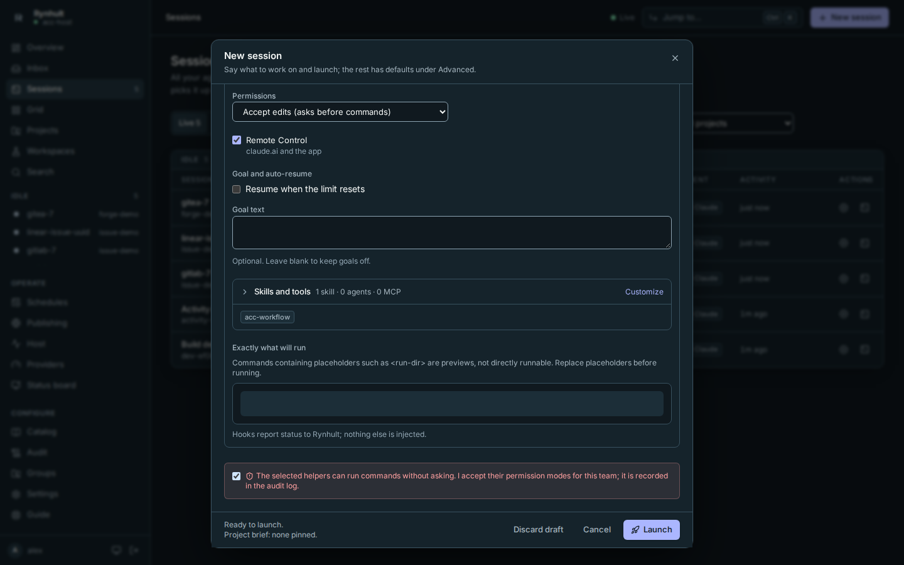
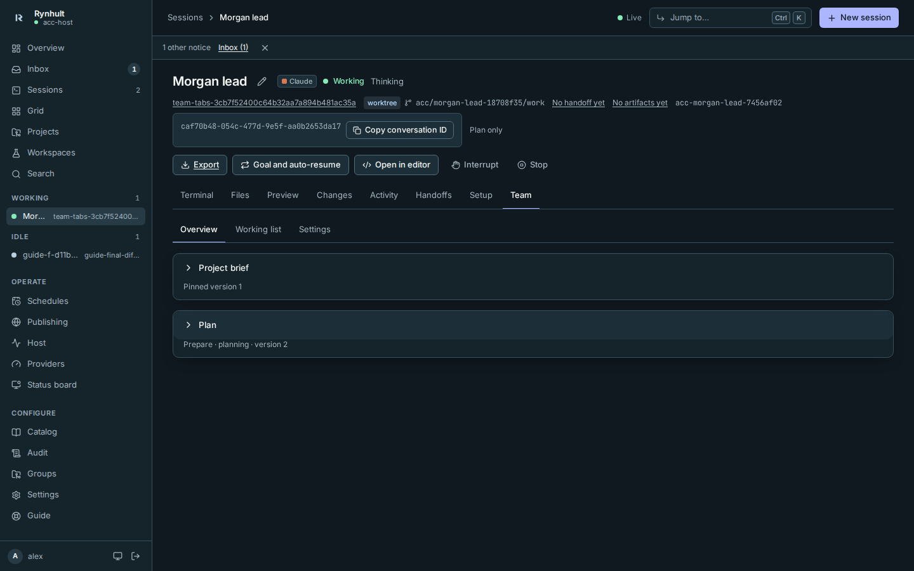
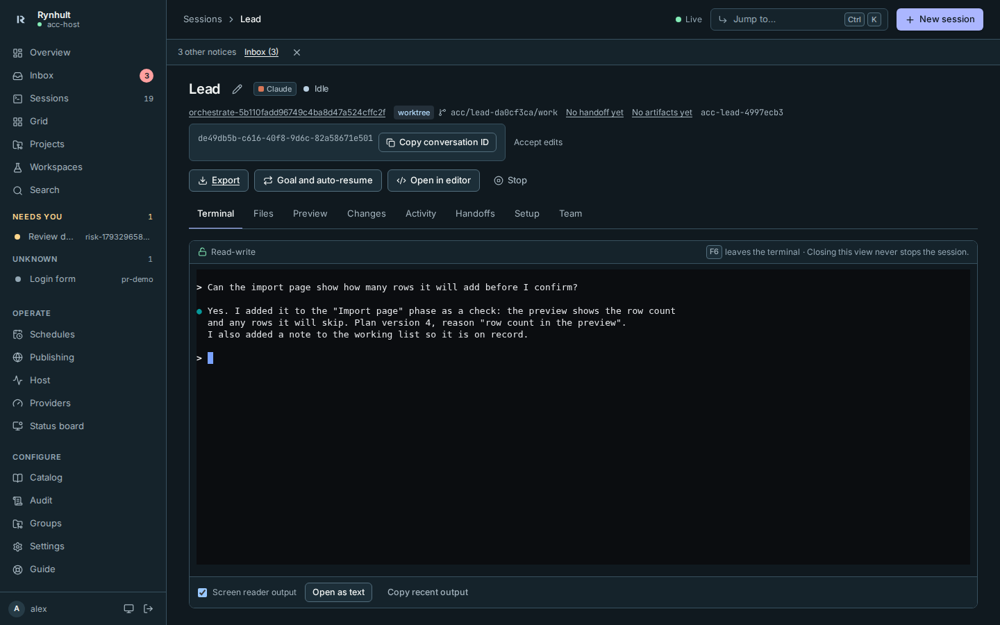
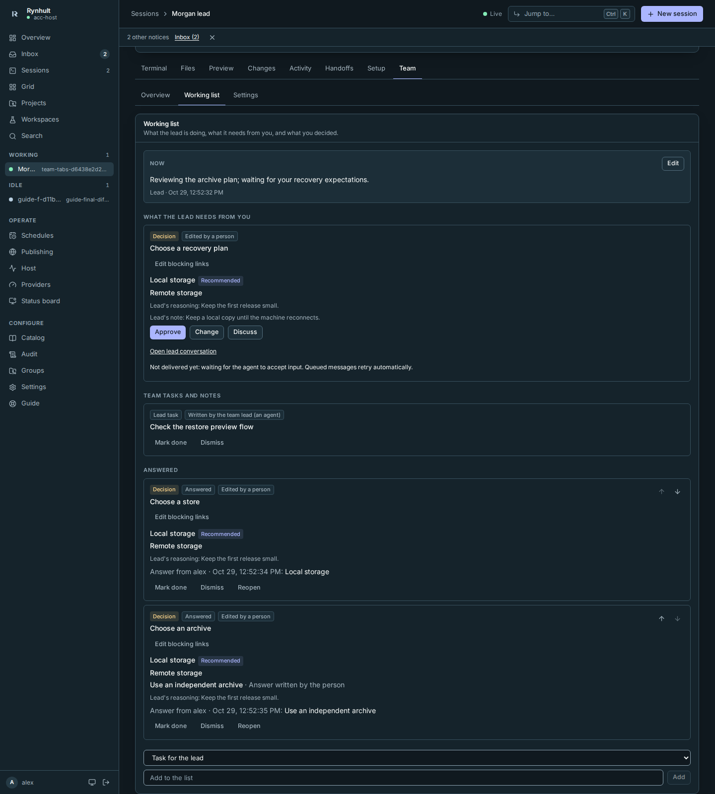
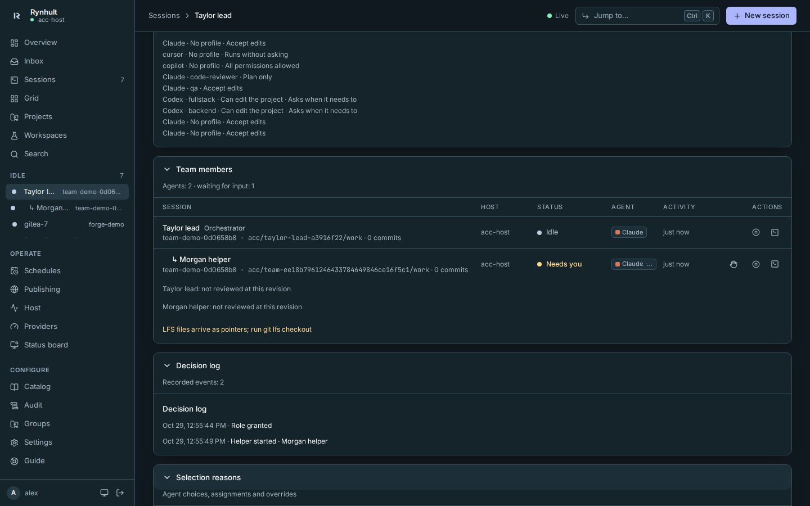
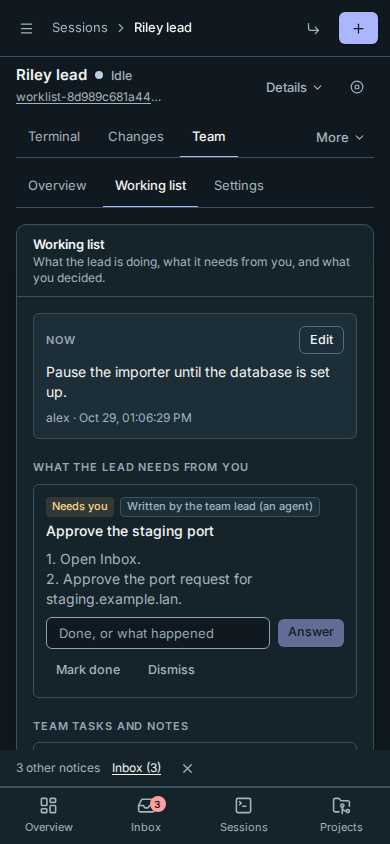
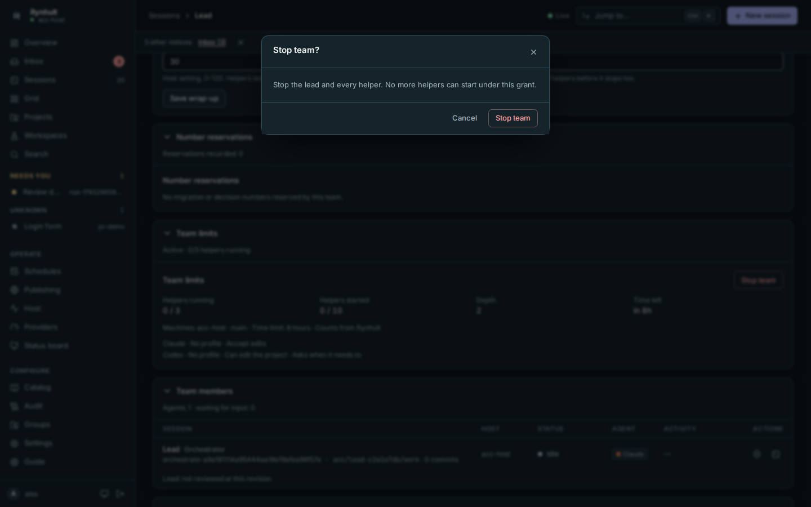

# Try Orchestrator v2 in 20 minutes

A first try of the Orchestrator v2 preview on your own Rynhult, with a throwaway project and a small real idea. You
turn the preview on, plan with a lead, answer its questions (from your phone too), let it start one helper, stop
everything, and turn the preview off again. Nothing you already have is touched.

The full walkthrough is the Guide's **Orchestrate a project** page, and every screen is described on
**Orchestrator**.

## Before you start (2 minutes)

1. You're an **owner** of this Rynhult.
2. **Claude Code is signed in** for your agent account: **Providers** shows it signed in on this machine.
3. **Optional:** your phone is set up (Guide → **Connect your phone**). You need it for step 7.

## 1. Turn the preview on (3 minutes)

The preview is off until an owner turns it on for the whole installation. There are three switches. Each adds a part
of v2 on top of the one before.

| Switch | What it adds | For this try |
|---|---|---|
| `ACC_ORCHESTRATOR=1` | The preview itself: the live agent tree, explained helper choices (**Selection reasons** and **Selection allow-lists**), the gate queue's settings, and the team tools agents use | **On**: nothing below works without it |
| `ACC_ORCHESTRATOR_V2=1` | The planning session, the versioned plan with its roadmap, and the working list with its decision cards | **On**: this is what you're trying |
| `ACC_ORCHESTRATOR_V2_DELIVERY=1` | Messages to helpers that are confirmed as received, helpers' reports that arrive back as cards, and a one-line note from Rynhult that wakes the lead when you answer | **On**: it lets you see a helper's report arrive, and the lead pick up your answers by itself. Leave it off if you'd rather keep the first try smaller |

Two more parts stay **off** for this try:
- **The gate queue:** it needs test commands for the project, and it runs branch code outside the helpers' sandbox.
- **Use fresh provider quota in selection:** helpers would be chosen by your plan usage as well.

On the Rynhult machine:

```sh
sudo tee -a /etc/default/accd >/dev/null <<'EOF'
ACC_ORCHESTRATOR=1
ACC_ORCHESTRATOR_V2=1
ACC_ORCHESTRATOR_V2_DELIVERY=1
EOF
sudo systemctl restart accd
```

If `/etc/default/accd` already has any of these lines (for example `ACC_ORCHESTRATOR=0`), change them there instead,
so each appears only once.

**What you should see:** after a moment, Rynhult loads again. In **Settings**, the section chooser lists **Selection
allow-lists**, and a project's page has a **Gate queue** card.

## 2. Make a throwaway project (1 minute)

1. **Projects → New project**.
2. Choose **Empty folder**, name it `try-orchestrator`, and keep **Trust it for agent sessions** ticked.
3. Select **Create project**.

**What you should see:** the new `try-orchestrator` project (its page, or its card on **Projects**).

## 3. Start the lead with a small real idea (2 minutes)

1. Select **New session** and choose `try-orchestrator`.
2. In **Task**, write a small idea in your own words. For example: "A small command-line tool that turns a CSV of
   contacts into vCard files, with tests."
3. Open **Advanced**, then under **Run** choose **With helpers**.
4. Keep the first try small and cheap:
   - **At once** 1, **In total** 2, **Depth** 1, **Hours** 1;
   - **Machines:** this one;
   - **Agents:** Claude only, with the permission mode **Asks before acting**.
5. Select **Launch**.



**What you should see:** the lead's session opens, named from your task. Open its **Team** tab. The **Plan** card says
*Planning session: no helpers start until the lead finishes the plan.*

## 4. Plan it together (5 minutes)

1. Watch the **Plan** card fill in: the idea, what's in and out of scope, the phases, and a **Roadmap** diagram.
2. Talk to the lead whenever you like: open its **Terminal** tab and type, for example, "Keep it to CSV for now; no
   Excel." It records what you agree in the plan.
3. To change the plan yourself, select **Edit plan** on the Team page's **Overview** tab. Your edit becomes a new version under your name.





**What you should see:**
- **Plan history** grows a version each time the plan changes, with the reason.
- The lead also commits `docs/ROADMAP.md` to the project.

## 5. Answer the cards (3 minutes)

The lead's questions arrive on the **working list**, under **What the lead needs from you**, and each also shows in
your **Inbox**:
- **Decision** cards (on the **Working list** tab): **Approve** takes the recommendation, **Change** picks another option or types a different answer, **Discuss** sends the lead a short message about the card and leaves it open.
- **Question** cards: type an answer, then select **Answer**.
- **Needs you** cards: do the steps, then select **Mark done**.

You can answer in any order, whenever you like. Until you do, the lead goes ahead with the card's **Default until you
answer**, but only with work it can undo.



**What you should see:** after its next turn, the lead marks your answer *Read by the lead* and notes what changed.
With `ACC_ORCHESTRATOR_V2_DELIVERY=1`, an idle lead gets a line from Rynhult saying you answered, so that turn comes
by itself. Without it, type "check the list" in the lead's terminal.

## 6. Let it start a helper (2 minutes)

Tell the lead in its terminal when you're happy with the plan, for example "The plan is good, go ahead." It finishes
the plan and starts a helper for the first phase.



**What you should see:**
- The **Live agent tree** shows the helper as working.
- **Selection reasons** say why Claude, its model and this machine were chosen.
- If the helper needs a permission, its row shows **Needs you**. Answer it in the helper's terminal, or from
  **Answer in Inbox**.

## 7. From your phone (1 minute)

1. On your phone, open Rynhult and go to **Inbox**.
2. Tap a card's item ("The team lead (an agent) asks: …"). It opens the lead's session: go to **Team**, and answer as in step 5.
   The working list fits the phone's width.



**Good to know:**
- Your phone gets a **notification** when a helper needs a permission.
- A card's question shows in the **Inbox** without a notification, so open the Inbox to see new ones.

## 8. Stop everything (1 minute)

1. On the lead's **Team** tab, select **Stop team**, then **Stop team** again to confirm.



**What you should see:**
- The card says **Team stopped**, and the lead and the helper stop.
- The plan and the working list stay on the Team tab for the record, and their questions leave your Inbox.
- What the helper committed stays on its branch in `try-orchestrator`.

## 9. Switch the preview off again (1 minute)

On the Rynhult machine, remove the three lines and restart:

```sh
sudo sed -i '/^ACC_ORCHESTRATOR\(_V2\(_DELIVERY\)\?\)\?=1$/d' /etc/default/accd
sudo systemctl restart accd
```

**What you should see:**
- **Settings** no longer lists **Selection allow-lists**, and the project page has no **Gate queue** card.
- Teams launched **With helpers** still work, as before v2.
- Anything the preview left running ends with "The orchestrator preview was turned off" in its history.

## What stays

- **In the database:**
  - the team's plan with every version;
  - the working list and your answers;
  - the selection reasons;
  - messages and reports.

  They're unused and hidden while the preview is off, and come back if you turn it on again. To delete them, follow the
  Guide's **Orchestrator → Data it keeps**: stop Rynhult, back up, run `scripts/orchestrator_v2_purge.sql`, start
  again.
- **The sessions, conversations and the project** stay like any others. To tidy up:
  - archive the two sessions;
  - archive the `try-orchestrator` project;
  - delete its folder from your workspaces folder if you don't want the code.
