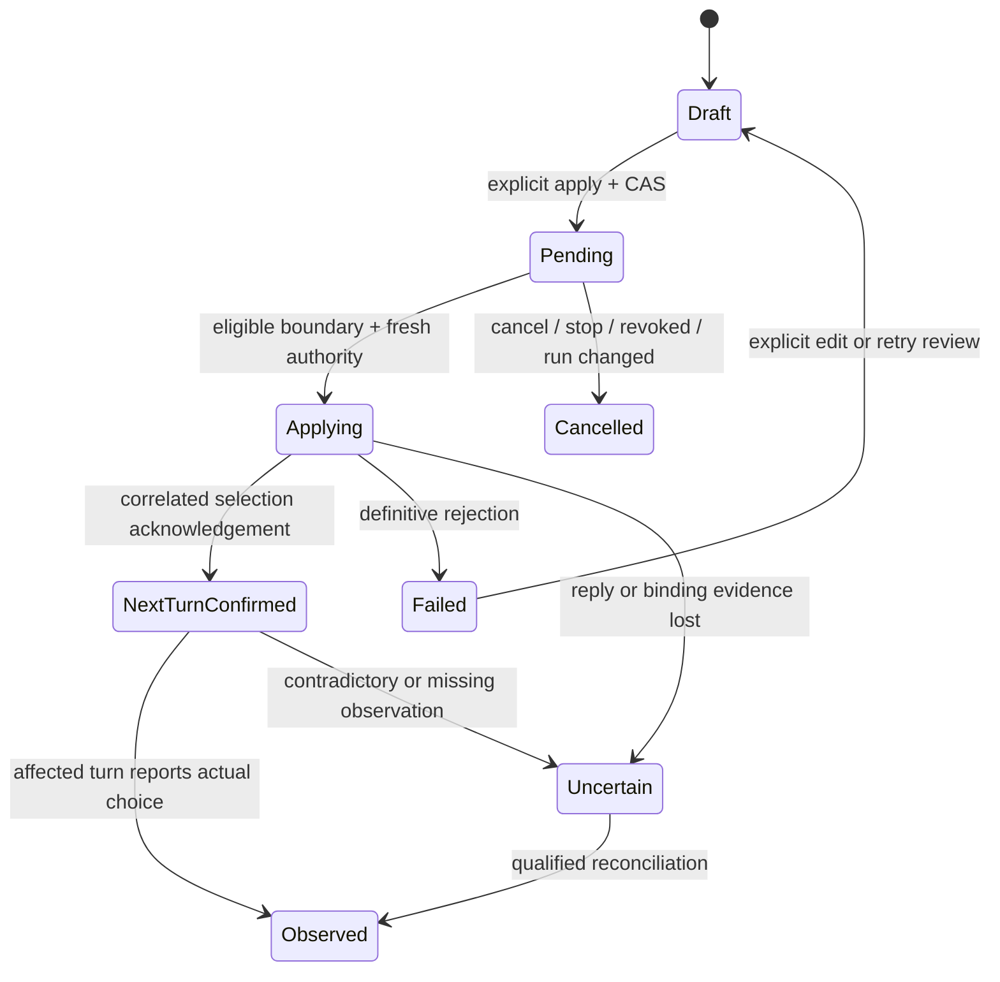

# P3c: model, effort and team deployment

> **Status: approved design (Josh, 2026-11-01).** Not yet implemented; implementation follows the redesign phases and their own reviews and qualification.

**Status: design proposal, 2026-11-01. No product implementation or enablement.**
Base: `main-475e` (`475e6063`). This specifies W5/W6, AC-031–AC-034 and S12 from the planning handoff. It extends [Chat beside the live terminal](chat-view.md), the [P3a adapter specification](chat-p3a-adapters.md) and the [continuity contract](continuity-contract.md); it does not replace their provider gates, draft protection, input authority or same-process requirements. P3a remains read-only; P3b must qualify input before a composer can send. No migration, launch-mode change, new listener, provider upgrade or permission relaxation is delivered here.

## Decision

Model and effort are **selected-session execution choices**, not layout preferences and not team-wide defaults. Show what the provider actually reported, what the person requested, and when a qualified change can take effect. Preserve the current process and conversation for an in-place change. Otherwise offer an explicitly reviewed, separately identified launch; never manufacture continuity by spawning another client against a running native conversation.

Start with **next-turn changes only** for qualified transports, even where a CLI can change between model calls inside a turn. This gives one visible boundary and prevents a single task from silently switching cost/capability halfway through. It is a Rynhult policy choice, not a claim that every provider has identical native behavior. Busy sessions may retain an explicit cancellable request for the next eligible turn. No interrupt, restart, relocation, provider substitution or human-prompt clearing is implied by selecting a value.

Existing terminal-managed sessions have no newly qualified Rynhult model-control channel at this baseline. They keep an honest Terminal/manual path or a reviewed new-launch path. A CLI's launch arguments, native picker, protocol method or transcript field alone do not qualify remote control of that existing TUI.

## Inputs and visual reconciliation

Planning inputs are the supplied `claude-handoff.txt` W5/W6, `acceptance-criteria.csv` AC-031–AC-034, `state-contracts.csv` S12 and `workflow/chat-controls.jpg` under the coordinator's `ux-direction/astra-2026-10-31/rynhult-planning-handoff/` package. These are design inputs, not public runtime APIs.

The inspected mockup puts Model and Effort below the composer, a timing summary underneath, Send at its edge, and a Workers tab plus a managed-worker link. It illustrates a selected model/effort and next-turn timing; it does **not** prove those controls work for every provider, that a header value describes the active turn, or that the shown worker count includes opaque subagents. Keep the placement and calm hierarchy; add effective/pending separation and honest capability/error states. Use [DESIGN.md](DESIGN.md) primitives, words as well as color, and the approved full-Chat/companion/phone layout rather than deriving another shell from this image.

## Evidence and provider support

Evidence labels: **D** = rolling official documentation read 2026-11-01; **O** = observed installed CLI in an isolated local fixture; **U** = unverified behavior, unavailable for product enablement. A local fake service proves request/control plumbing, not real model access, inference, billing, provider policy or end-to-end Rynhult safety.

`deploy/packages/acc-packages` pins Codex **0.163.0**, Copilot **1.0.103**, and the non-apt Claude native target **2.1.308**. Its apt Claude entry uses the signed repository and hold, not an exact version. Detect actual version on every target; matching a provider name or a launch `supports={effort}` flag is insufficient. All three installed binaries reported these exact versions under fresh temporary homes.

| Provider and mode | Native supported mechanism / timing | Evidence and product decision |
|---|---|---|
| Claude Code 2.1.308 TUI | `/model` changes selection; an active response is not rewritten. Effort has precedence and a later model-call/message boundary; it is not retroactive. | D; ordinary `/model <name>` can save a user default. Session-only picker choice exists. TUI automation, busy behavior and session-only side effects are U here. No automatic slash-command injection. |
| Claude protocol-owned streaming-input process | Dedicated model control; SDK `applyFlagSettings` can change model and effort. Model may affect the next model call within the current turn; effort is model/cache dependent, by the next turn. | D; O for an idle same-process model change and a subsequent `/effort high` local command in print/stream mode. General runtime effort setter and busy/cache boundaries are U. Initially defer dispatch until the turn ends. |
| Codex 0.163.0 TUI | `/model` selects a model and supported reasoning effort; status can confirm selection. | D; U for automating this pinned TUI, persistence side effects, busy picker and actual first affected turn. A newly started app-server is not an attach method. |
| Codex protocol-owned app-server | A turn-start request can supply model and effort for the same thread; later defaults and actual turn observations must be distinguished. | D; O for two completed turns with different model/effort request pairs on one process/thread. No active-turn steering or existing-TUI attachment was tested. Initial support targets an idle next turn only. |
| Copilot 1.0.103 TUI | `/model` picker supports model and, where offered, effort; documented selection applies when idle or after the active turn finishes. Session scope differs from global/repository defaults. | D; U for pinned TUI interaction, real account catalog, effective-request observation and busy timing. Do not use `/config model`, global or repository modes for this control. |
| Copilot protocol-owned ACP | Model setter was accepted in an isolated ACP session. Server-start effort flags configure its sessions; the fixture advertised no effort option. | O only for setter acceptance, not an inference turn. Dynamic effort is U; launch-time effort is confirmed by help. For this adapter, effort requires a reviewed new launch until a per-session channel qualifies. No listener or shared ACP server is proposed. |
| All three, launch/resume | Existing adapters compile model/effort launch arguments. | Repository evidence and O help output. Launch support does not prove resume preserves runtime changes. An unsupported in-place change may be offered only through a reviewed new launch with fresh policy checks. |

Official sources, with deliberately limited interpretations:

- [Claude model configuration](https://code.claude.com/docs/en/model-config): session-only versus saved model selection, effort precedence and message timing. In particular a displayed effort setting can lead the effort actually used by ongoing work. Native fallback/alias resolution can also make requested and reported models differ. Do not label a requested alias as the resolved model.
- [Claude streaming SDK controls](https://code.claude.com/docs/en/agent-sdk/typescript#applyflagsettings): `setModel()` and runtime flag settings are streaming-input controls; model changes can affect later calls in the same turn, while effort can wait. This is a candidate for a process owned from launch, not permission to expose the general settings setter to a browser.
- [Official Codex CLI commands](https://developers.openai.com/codex/cli/slash-commands/) (redirects to ChatGPT Learn): native selection/status workflow. [Codex App Server](https://developers.openai.com/codex/app-server/): model catalog with effort options and per-turn configuration. Neither establishes takeover of another process's TUI or qualifies every pinned schema field. Use the installed schema and versioned fixtures before implementation.
- [Copilot model selection](https://docs.github.com/en/copilot/how-tos/copilot-cli/use-copilot-cli/choose-a-model): idle/busy timing, model/effort picker and session scope. [Command reference](https://docs.github.com/en/copilot/reference/copilot-cli-reference/cli-command-reference): distinguish session scope from saved defaults, and do not assume native subagents always honor the parent's requested model.
- [Copilot ACP](https://docs.github.com/en/copilot/reference/copilot-cli-reference/acp-server): server-start settings affect sessions it creates/loads; effort in `session/new` is not an established per-session runtime setter. A newly launched ACP process does not establish control of an existing TUI.

### Disposable native checks performed

Every native process had a fresh HOME, provider config roots and XDG config/cache, an empty working directory, and an environment built from scratch. There were no inherited account credentials, ACC/Rynhult session variables, MCP configurations, hooks or real conversation IDs. Fixed dummy credentials (`fixture-only`) pointed at an owned ephemeral loopback HTTP fixture. Telemetry/update/nonessential-traffic switches were disabled where applicable; proxy-aware external traffic pointed at unused loopback port 1 with only loopback excluded. This was not an OS network sandbox. No real inference, tool calls or provider account was used.

| Probe | Observed result | Limit |
|---|---|---|
| All three `--version` and `--help` | Exact versions above; Claude `--model`/`--effort`, Codex `--model`/config override, Copilot `--model`/`--reasoning-effort` | Help proves parsing/documentation, not runtime effects. Copilot help lists model-dependent effort tokens; not all work for all models. |
| One `codex app-server`, fresh custom fixture provider, `initialize` → `thread/start` → two `turn/start` requests | Same live process/thread; both turns completed. Fake endpoint received `gpt-5.4` + `low`, then `gpt-5.4-mini` + `high`. | Only explicitly supplied per-turn overrides; sticky defaults, busy steering, failure rollback, TUI and real entitlements remain U. Names are fixture values, not product defaults or recommendations. |
| One `claude -p --input-format stream-json --output-format stream-json --verbose --tools "" --strict-mcp-config --setting-sources "" --model claude-sonnet-4-6 --effort low` | First ordinary turn requested Sonnet/low. A `set_model` control to `claude-opus-4-6` succeeded after a model-validation request. `/effort high` was processed as a local command; the next ordinary request was Opus/high. Results retained one native session ID and the process stayed alive. | Model validation was a separate request with no effort value; it was not a conversation turn. Print-mode slash behavior is not TUI qualification, nor proof of the general effort setter. |
| Deliberately inadequate first Claude fake response | Model-control reply was an error; later ordinary request remained Sonnet, with the separately selected high effort. | Failure of this fixture's validation response, not a reported product defect. Demonstrates why setter acknowledgement and subsequent observations matter; there was no product draft in this fixture. |
| One `copilot --acp --no-auto-update`, BYOK dummy configuration | `initialize`, `session/new`, `session/set_model` and session close succeeded. Session advertised mode/allow-all configuration options, not an effort option, and no current model value. | Setter success alone is not proof of the model used. No completion/model-effort effectiveness claim. An unadvertised effort-option probe is recorded in the handoff. |

The corrected Codex probe used a fresh empty config instead of `--ignore-user-config`: that flag is accepted by exec but rejected by this version's app-server command. Early attempts therefore provided no runtime evidence. All fixture processes and the HTTP server were owned and stopped; temporary homes were removed. No fixture helper or raw provider dump is shipped in this docs-only change. Sanitized results and reproduction boundaries are recorded in the handoff.

## Effective, pending and observed configuration

Do not overload today's launch inputs or a single `model` string. `src/acc/server/orchestrator/live.py:member_data` currently reads its model from immutable launch inputs; that is **launch configuration**, not a live provider observation. P3a transcript metadata is historical evidence, not proof of the active turn. Keep both truthful labels while a new observation protocol is qualified.

Proposed logical record, not an implemented schema/API:

| Field | Meaning |
|---|---|
| Binding | Installation authority epoch, authorized Rynhult session ID, verified `SessionRun.id`, provider/version, native ID, machine/account and placement. The server resolves it; the browser cannot replace it. |
| Launch selection | Immutable compiled model/effort and originating profile/team revision; useful provenance, never overwritten to pretend the process changed. |
| Acknowledged session selection | Provider-confirmed default for a subsequent call/turn, with adapter/version, operation ID and acknowledgement boundary. Not the active turn's configuration. |
| Effective observation | Reported resolved model and effort **independently**, with native turn/call ID, run, observation source, sequence and observed-at time. Missing effort remains unknown even when model is known. |
| Pending request | Desired model/effort, requested scope, actor, expected run/config revision, apply timing, operation ID and safe outcome. Kept distinct from the observation. |
| Capability | Per-field support, permitted values, model-dependent effort options, session-only transport, timing and qualification evidence for this exact version/mode/endpoint. Unsupported and unverified have reasons. |

A setting can be acknowledged for the next turn while the active turn still reports the previous pair. No active turn means show the next-turn selection separately from “Last turn used …”; do not invent active inference. An unobserved/default/auto effort is not Medium. Reported actual fallback or an external manual change is shown as such; it must not become success for a different pending request.

Do not obtain confirmation by sending a synthetic user question, generating a turn, scraping private reasoning or testing a model with a hidden paid task. Prefer a qualified control acknowledgement plus correlated turn/call metadata. An independent model-list subprocess can discover a catalog, but cannot attest the running session's state. When a provider exposes only weak/missing evidence, show “Last confirmed … / Current choice not confirmed” and leave effectiveness unknown.

Capabilities come from the authorized target account/endpoint and existing policy/readiness. A cached catalog, model alias, response body or transcript instruction does not authorize an endpoint, broader permission or provider switch. Refresh unavailable catalogs with an explicit read; do not probe arbitrary browser-supplied URLs or silently choose another model/effort. Offer provider-native tokens only when supported by the selected model; no universal slider that maps High to an invented equivalent. A single-model endpoint may leave model fixed and effort unsupported. Claude endpoint environment pins and existing profile policy must be respected, not removed to make a selector work.

## Apply protocol and state transitions

Proposed browser command accepts only Rynhult session identity, expected binding/config revision, opaque operation ID, and desired **model/effort**. It carries no executable, PTY command, native ID, endpoint URL, account path, general settings patch or reusable writer grant. Main authorizes using the existing session-control boundary; read-only viewers cannot apply. A future browser route requires a person sign-in and existing CSRF/origin/device admission, not an agent's installation token. No new general agent control tool is implied.

1. **Prepare locally.** Editing selectors creates a distinct session-scoped settings draft. Keep composer text, attachments and terminal input separate and unchanged. Restoring a draft never applies a setting. Validate the pair and show timing/cost/context implications if known, not invented prices. Unsupported combinations remain visible with an explanation and Terminal/new-launch choices.
2. **Review/apply explicitly.** Apply next turn records a durable operation with an expected configuration revision and current binding. Two tabs/devices race by CAS; the loser gets the current record and keeps its local draft. Changing a value never auto-sends a chat message. No cross-person/global default file is rewritten.
3. **Wait safely.** If busy, retain `pending/waiting_for_turn_end` only after explicit confirmation of that timing. Hold no database transaction or PTY lease while waiting. Block on approval/login/trust prompt, human terminal draft, uncertain input, composition or unknown provider state. Never type into or dismiss those surfaces. Stop, expiry, cancellation, revocation, host loss or run change fences the pending operation; restored operations do not attach themselves to the next run.
4. **Claim at the boundary.** Use the same per-session arbiter as Terminal, Chat and team delivery, with a configuration revision as well as writer/run/epoch fencing. Reauthorize after awaits and immediately before dispatch. Serialize model/effort transitions with turn start so no competing input can start under the wrong pair. An existing terminal writer is not silently taken; request the existing explicit handoff. Structured control still respects this boundary even if it is not PTY bytes.
5. **Dispatch narrowly.** For an owned Claude streaming process, adapt dedicated model control and an allowlisted effort control only; never forward arbitrary flag settings. For an owned Codex thread, bind explicit model/effort to the intended next turn rather than a second process. For Copilot, enable only a qualified advertised per-session mechanism; a server-start-only flag requires new-launch review. TUI automation remains disabled until session-only commands, prompt recognition and correlation qualify. No automatic default-writing slash command, shared config edit or second resume process.
6. **Acknowledge then observe.** Store the adapter's correlated acknowledgement and next-turn selection without replacing the current effective observation. First affected turn/call metadata establishes effectiveness. A send intended for a requested selection must reference that selection/config revision and wait for its eligible boundary; do not silently send using the previous pair. Codex can combine configuration with its explicit `turn/start` message under P3b's send receipt; that one user-authorized message is the first affected turn, not a hidden confirmation prompt.
7. **Reconcile failure.** A definitive pre-dispatch refusal keeps the last real effective choice and all drafts. If one field changed before another failed, record the actual partial result and show the unfulfilled field; do not claim atomic rollback. Loss of acknowledgement after dispatch is `uncertain`, with last-confirmed values labelled stale. Query a qualified status/receipt rather than replaying a setter or resending a message. No silent restore/restart/fallback. Preserve the text and attachment draft through every failure and cancel.

Cancel succeeds only before a dispatch claim; a racing claim answers with its real state. Once configuration reached the provider, Cancel cannot promise undo. Reverting is a separate explicit change. A queued chat message bound to a cancelled/failed selection remains unsent, with its draft/receipt visible. Never retry an uncertain P3b message merely because a configuration operation failed. Pending operations have a bounded expiry and one active intent per session; expiry returns a clear draft/review state rather than hiding a permanent fence. Implementation chooses the durable schema/retention limit during review; no migration number is reserved here.

Metadata-only audit covers request, cancel, dispatch, acknowledgement, failure/uncertainty and reviewed new-launch outcome: actor, target session/run, operation/revision, requested and observed model/effort, safe reason and timestamps. No prompt, attachment bytes, raw provider error, private endpoint URL, credentials or complete launch specification. Polling observations are bounded state updates rather than per-token audit events. Reuse existing redaction and rate/resource bounds; never hold a database session across a target call.

### When another launch is required

Explain “This session cannot change effort in place. Review a new launch” (or model, as applicable); do not label it Apply. Review identifies old session/run, native conversation continuity if supported, target provider/model/effort, same intended host/account/worktree, access/guard/profile settings and what cannot be retained. Changing provider is a separately reviewed new session, never an in-place model substitution. Changing the model does not authorize moving a task to another host/account or widening mounts.

Only explicit confirmation may stop/fence the original provider and create a new immutable launch specification and separately identified run/session with a continuation link. Verify the old writer is closed before resuming the native ID; never run two processes against it. Preserve authorized history and the person's local draft without auto-sending, reusing old control grants, transferring pending approvals or manufacturing a second kickoff. If stop cannot be verified, do not launch. If launch fails, show the original stopped state and an explicit recovery path, not automatic resurrection or a replacement marked successful.

Initially, if a team lead/helper replacement cannot preserve its assignment/attempt identity and existing lifecycle rules through an already supported orchestrator transition, say that the transition is unavailable. Do not rewrite a running team's membership or retarget workers merely to offer restart. Ordinary existing resume keeps its frozen launch behavior until separately changed by an explicit reviewed mechanism; the UI must disclose if a resume would revert an unrecorded manual choice.

## Controls and S12 copy

Place Model and Effort beside/below the selected session's Chat composer in both full and companion views. The label includes the selected session/worker. A worker selection navigates to its own authorized session; a lead's control never broadcasts. On a narrow screen controls wrap into labelled rows or a configuration disclosure; maintain composer/Send access above the keyboard and preserve reading position. No duplicate control writers when layouts change.

| Real state | Visible text / available action |
|---|---|
| Active turn observed | “Current turn: [reported model] · [reported effort]”, with provenance/age available in details. |
| Next-turn selection acknowledged, old turn active | Current turn remains unchanged; separately show “Next turn: [selection]”. |
| Edited locally, not applied | “Not applied” with Apply next turn and Discard selection; composer draft untouched. |
| Busy request retained | “Pending for the next turn; current work is unchanged” with Cancel pending change. No claim of immediate effect. |
| Evidence absent / disconnected | “Current choice not confirmed” plus last-confirmed value/time where available; no empty/default invention. |
| Definitive failure | “Could not change [field]. [Last confirmed choice] remains in use” only if evidence supports that claim; otherwise show unknown/partial state. Keep selection and composer drafts for explicit review. |
| Unsupported field or unqualified transport | Explain the exact limitation; Open Terminal or Review new launch as supported. Disabled controls retain an accessible explanation. |
| Unexpected provider substitution/fallback | “Provider reported [actual]; requested [desired]” and a review notice. Do not relabel it as the selected model or retry automatically. |

Do not promise the two-field pair is atomic when the native transport cannot guarantee that. Default/Auto uses provider semantics and shows a resolved model only when observed; it is not a fixed model. Warn about a provider-native default-writing action before directing a person to it; prefer the native session-only picker choice where available. Do not inject `ultrathink` or rewrite task text to simulate effort. Changing effort must not toggle a provider's agentic workflow mode or permission mode.

Use labelled native selects or existing accessible selection primitives, keyboard operation, visible focus and a single coalesced polite status announcement. Applying a selection must not move focus to Terminal, steal its writer, collapse a tool/approval dialog or clear IME composition. Errors are announced without reading sensitive provider strings. At 390/1440 px, light/dark and 200% zoom, pending/effective values and Cancel remain readable without page overflow. No validation polling per keypress or hidden per-worker watcher.

## W6: deployment without invented workers or settings

Use the existing orchestrator live tree/events and assignment/attempt records as the managed-worker source, with current authorization on snapshots, updates and links. Extend their safe projections; do not send full launch inputs, tasks, grants or account credentials merely to populate a row. Each managed worker has a Rynhult session ID and its own observed configuration record. Opening one never launches, takes control or changes the lead's configuration.

| Field | Source and honest absence |
|---|---|
| Lead/worker and assignment | Managed session relation plus current assignment/attempt identity. A task title is redacted display metadata, not an instruction or grant. Missing assignment is “Unassigned/unknown” according to evidence. |
| Source/location | Server-authorized project/repository and actual checkout/worktree/placement identity. Distinguish the logical source from execution location; no guessed path from a display label. |
| Host and account | Authorized machine/placement/session records. Offline or stale is shown with age, not substituted by the main host. Suppress metadata the viewer cannot access. |
| Provider/version | Compiled provider plus observed executable version. Missing version is unknown, not the fleet's pin. |
| Model/effort | Launch selection labelled as such; independently reported current/last-turn values, provenance/age, acknowledged next-turn selection and pending request where available. Never copy the lead's choice or translate a missing effort into a default. |
| Execution | Existing observed execution state, stop/expiry status and run identity. Missing/unreachable is unknown/stale, not Idle. |
| Attention | Independent approval/decision/blocked/failure state with authorized link; can coexist with execution. Viewing or dismissing is not approval. |

Changing a lead's model/effort does not mutate existing managed workers, their immutable specs, next-turn selections, pending requests or assignment attempts. Editing a saved team/profile affects future launches only. Future assignment selection still follows the team's frozen authority, explicit per-assignment profile choice, catalog/readiness, budget ceilings, helper/time limits and scoped grants. No hidden helper creation, permission expansion, budget reset or timer extension accompanies a model change. If policy also governs an in-place worker change, evaluate it explicitly; changing a label must not bypass selection ceilings.

Show provider-native subagents in a separate **Provider-reported subagents** section only when a qualified source supplies bounded observations. They are not managed worker sessions. Otherwise say “Native subagents are not observable here” without inventing counts, host/model/effort, assignment ownership, current state or control links. The provider may choose a model or inherit at dispatch according to its own rules; this design cannot freeze or reconfigure opaque native agents. It does not promise that a lead choice leaves every future native subagent's defaults unchanged. Running managed workers remain independent; opaque native children cannot be advertised as satisfying managed placement/grant/stop guarantees.

A native message mentioning “three helpers” is untrusted content, not authority to add three managed rows or a team-count badge. Prefer an explicit managed count and an independently qualified native observation count; never merge the two. Model/effort selectors do not enable unsupported native-subagent control.

## Delivery slices and qualification gates

All cases below are **planned implementation tests**, except the narrow native checks recorded above. No UI or product security GO is claimed by this design.

| Slice | Deliverable | Release gate |
|---|---|---|
| C1: truthful reads | Safe configuration observations, provenance, immutable launch labels and selected-session/worker identity; unsupported controls explained. | Per-provider/version/mode parser fixtures and authorization. Model known/effort unknown, stale/offline, aliases, endpoint pins, manual changes and provider fallbacks. No selector or transcript metadata becomes authority. |
| C2: pending intent | Session/run/revision-bound setting drafts and durable CAS operations with cancel/expiry/uncertain states; no dispatch yet. | Two people/devices, revision race, reload, sign-out, role/revocation and stale run/epoch; failed storage, no lost composer text/attachments, no permanent fence, metadata-only audit. |
| C3: one qualified next-turn adapter | Owned Claude streaming or owned Codex protocol, separately from existing TUI; explicit apply/send boundary. | Real pinned CLI + loopback fixture then authorized provider-account qualification: idle/busy boundary, exact first affected call/turn, rejection/partial failure, default-file invariance, same PID/native ID/run and unchanged hook/permission/MCP policy. No silent restart or substitution. |
| C4: other adapters / reviewed new launch | Copilot only as its actual per-session mechanism qualifies; explicit launch fallback otherwise. | No arbitrary ACP config patches, no shared-server effort mutation, retained launch policy, old-run fencing, startup failure recovery and native-conversation continuity without parallel writers or second kickoff. |
| C5: deployment refinements | Managed rows and optional native observations with truthful per-row state. | Independent worker authorization, configuration and execution/attention; saved-team future-only behavior, assignment/attempt consistency, no forged native counts or control/placement expansion. |

Required focused qualification scenarios:

1. **AC-031 / S12:** for each CLI version/mode/endpoint, supported/unsupported/model-dependent combinations, fixed model, Default/Auto, restricted/unavailable catalog, loading/error/unknown and busy/approval/login/trust states. Hold a fake response mid-turn; prove Rynhult's next-turn policy never changes that turn, even if the CLI supports it natively. No change merely from selection, reload or restoration.
2. **AC-031 failures:** stale revision/run, both race orders of cancel versus claim, Stop/expiry/revocation while waiting and during awaited target calls, target disconnect, validation failure, permission refusal, partial model-success/effort-failure, reply lost after dispatch and main/broker/provider crashes at every boundary. Query/reconcile rather than replay; do not erase drafts, fake rollback, silently send with old settings or leave an unreviewable permanent pending state.
3. **P3b integration:** Chat, Terminal, automated delivery and configuration race through one arbiter. Preserve human partial input and IME; never answer approval/password prompts, type slash commands into a shell or steal a writer. Correlate the requested configuration with the intended send/turn receipt. Double click yields one operation; uncertain message never resends because a setter timed out. Count PID/native ID/process starts before and after.
4. **AC-032:** lead plus at least two running managed workers with different providers/model/effort. Change the lead, compare every worker's launch spec, runtime observation, pending choice, operation revision, run, worktree, timer and grants before/after. Then explicitly target one worker and prove all others remain unchanged. Check shared-account default files and other independent sessions too.
5. **AC-033:** deployment renders running, blocked, pending, failed, stopped, offline and unknown rows with separate execution/attention; accurate assignment/source/location/host/provider and independently known model/effort. Missing values stay unknown, historical observations stay dated, unauthorized rows/links/fields are omitted or neutral according to existing policy. Revocation during an awaited update emits no further private metadata.
6. **AC-034:** forged transcript worker names/counts/model metadata, opaque native subagents, stale selection policy, out-of-scope host/account/source, missing readiness, exceeded budgets/helper/time ceilings and read-only roles. No managed row, model-change capability, helper launch, permission override, broader path grant or provider/host substitution results. Native subagents have no invented Stop/model controls.
7. **Reviewed-launch path:** successful and failed stop verification, interrupted restart, native ID mismatch, guard/config drift, unavailable original model, stop succeeds/launch fails, original session archived and queued approvals present. No two writers or automatic recovery launch; clear separate session/run identity and explicit next action. Team transitions unsupported by existing lifecycle remain unavailable.
8. **Browser/device:** one focused spec file at a time, fake providers, own fixture/port; 1440/390 px, both themes, keyboard/reader, zoom and IME. Same selected-session state across full/split Chat, readable effective/pending summaries, focus preserved, explicit conflict/cancel/recovery, unsent text and attachments intact, zero hidden launches or settings applies. Real provider TUI and physical-device behavior remain separate manual gates.

No calendar commitment is implied. Enable one qualified capability/version/mode at a time; do not block truthful read-only deployment on an unqualified change control, and do not advertise writable parity from the existence of this plan.
