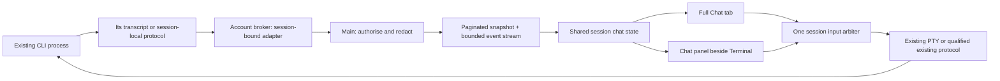

# Chat beside the live terminal

> **Status: approved design (Josh, 2026-11-01).** Not yet implemented; implementation follows the redesign phases and their own reviews and qualification.

**Status: owner-approved design direction, reconciled 2026-11-01 for P3a. This commit specifies adapters and qualification; it does not implement or roll out Chat.**

Base: `main-cfb3` at `cfb322ceb71c60e8f366570026389b21110ce0d3`. Detailed read-only adapter contracts, captured fixture evidence and capability gates: [P3a adapter specification](chat-p3a-adapters.md).

Based on the closed product-review decision: each session gets both an optional resizable Chat panel beside Terminal and its own full **Chat** tab, with images/documents/diagrams sent to that **same live session**. Chat can be the primary interface, selected by a per-person default tab. Keep the simple path for an individual person; reveal transport details only on failure or in diagnostics. This design does not start another conversation, replace the CLI, or add a hosted relay.

## Source reconciliation and owner decisions

The supplied approved text is
`/srv/acc/workspaces/handover/ux-handoff/_work/chat-view.md`, with the closed
owner record `_work/decisions-2026-10-31.md`. Its historical “proposal” header is
superseded by the coordinator's P3a brief. The record requires a scrollable Chat
view, images/documents/diagrams and the **same live session**, with quiet safety
protections and explicit authority for risky/outward actions. It is not approval
to disable guards, copy credentials or introduce a second conversation.

Josh's explicit amendment requires **both** an optional panel beside Terminal
and a full Chat tab usable as the primary interface. The original `design-chat`
commit `c3395e7a6` supplied a synthetic parser replay; its later layout revision
`7af764e4` supplied the split/full-tab detail retained here. The supplied text's
privacy, bounded following, input and attachment requirements remain intact.
Neither historical “wait for approval” footer nor tab-only wording should be
used to reopen the approved direction.

The consolidated planning handoff (`claude-handoff.txt`, Implementation phases)
and `state-contracts.csv` S08–S12 govern the P3a/b/c split: P3a = read-only
structured Chat and managed-worker visibility; P3b = separately qualified input,
attachments and receipts; P3c = model/effort transitions and team deployment
refinements. P3a includes full-tab and companion reading, **no enabled composer**.
Workers retain their own session identity and authorization. This document does
not implement worker UI or modify the concurrently developed shell.

Earlier split sizes, timings and storage suggestions are engineering defaults,
not additional settled owner decisions. In particular, P2 owns versioned
server-backed layout persistence; Chat uses that contract, not an independent
competing preference store. No dates or estimates from older proposals are
release commitments.

## Recommendation and feasibility

Add a read-only, structured transcript with side-by-side layout first, then qualify sending and attachments for each CLI version. Promote the full Chat tab to a primary-interface choice once sending works; the split panel remains available independently. Keep Terminal available throughout. Claude Code and Codex have usable on-disk message sources in today's adapters. All six adapters can supply some history; completeness and live update semantics differ. A chat view over saved messages is feasible without changing how sessions launch. Guaranteed token-by-token updates and rich tool output are a separate capability, not something the saved-history parser currently provides.

For existing terminal-managed sessions, send through the existing process's PTY, coordinated with terminal control and the delivery worker. Do **not** run `claude -p --resume`, `codex exec resume`, another TUI, or an ACP client process merely to send a message: sharing a native conversation identifier does not establish shared process ownership, preserve pending approvals, or prevent two simultaneous writers. Provider protocols are a later launch-mode project unless we can prove they attach to the exact running process with all its restrictions intact.

Initial support should distinguish `read_history`, `follow_messages`, `rich_tools`, `send_text`, `send_multiline`, `attach_image`, and `attach_document`. Each is qualified by provider/CLI/adapter version. Unsupported functions say why and link to Terminal; no provider-name guesses. The review's default-trusted image decision does not make a particular CLI attachment mechanism work: do not turn an uncertain transport into a claim that the model saw a file.

## What exists today

| Code | Reuse | Gap for Chat |
| --- | --- | --- |
| `src/acc/providers/transcripts.py` and each adapter's `messages_source` / `session_messages` | Known local formats, prompt-wrapper filtering, bounded reads | Text-only, mostly whole-snapshot reads; tools, images and thinking intentionally omitted |
| `src/acc/broker/ops.py:transcript_messages` | Account-local source discovery using the server-selected provider/native ID, modification stamp | Returns a bounded snapshot rather than a live event cursor; do not expose arbitrary path reads |
| `src/acc/server/history.py` | Account/node routing, vault redaction, searchable history | Background indexing is not a live transcript service; FTS sequence numbers are replaced on reindex |
| `src/acc/server/orchestrator/delivery.py` | Durable delivery identity, writer arbitration, authority/generation checks, prompt safety, acknowledgment and uncertain-send handling | `validate_text` collapses tabs/newlines to spaces; clearing keys are unsuitable for silently replacing a person's half-written prompt |
| `src/acc/server/api/files.py`, `src/acc/broker/files.py` | Scoped session workspace file operations and upload validation | Need immutable attachment identity, private staging, lifetime and container mapping; existing upload alone is not a chat send |
| `web/src/components/Terminal.tsx`, session tabs, delivery UI | Existing session, terminal and focus/accessibility behavior | New Chat surface must preserve the mounted terminal when switching views, or intentionally release its writer before sending |

Existing history limits are 5,000 messages, 8,000 characters per message, 64 MiB input per conversation read and 4 MiB per JSONL line. These are search safeguards, **not** a complete chat archive. Chat needs bounded pagination and explicit truncation/gap indicators; silently reusing these caps would lose later turns. Existing file limits are 4 MiB per upload and 16 MiB per batch.

## Provider evidence and support matrix

Paths below describe source layouts, not browser-supplied read paths. Resolve them under the selected agent account on its actual machine, bound to the recorded native session ID. Adapter comments record inspected versions (2026-10-21/22); that is repository evidence, not a fresh live qualification performed for this proposal.

| Provider | Transcript source currently understood | Following live work | Same-process input / remaining qualification |
| --- | --- | --- | --- |
| Claude Code | `~/.claude/projects/*/<native-id>.jsonl`; `user` / `assistant` records and message content blocks | Follow complete appended JSONL records. Render text blocks first. Tool-use/result blocks can later join by provider tool ID after fixture qualification; disk writes may arrive only at message boundaries | Existing interactive PTY. Qualify idle prompt, busy/approval refusal, multiline paste and workspace image/file references. A separate print-mode process is not an attachment to this TUI |
| Codex | `~/.codex/sessions/**/rollout-*-<native-id>.jsonl`; current parser takes `response_item` messages with user/assistant role | Tail complete records; choose the canonical message family, not both summary/event messages and response items. Function calls/results need versioned fixtures and call-ID joins. Rollouts are an internal format, not a stable API promise | Existing PTY for existing sessions. App-server is promising for future protocol-owned sessions, not proof that an independent server can take over an already running TUI |
| GitHub Copilot CLI | `~/.copilot/session-state/<native-id>/events.jsonl`; `user.message`, `assistant.message` in current parser | JSONL follower with event IDs where present; explicitly handle compaction/rewrites, assistant partial/final updates and version drift | PTY first, with independent send/attachment qualification. ACP exists, but starting an ACP server is not a proven attachment to this process; keep read-only if prompt or attachment mapping is unqualified |
| OpenCode | Account-wide `~/.local/share/opencode/opencode.db` (WAL), selected session rows; current reader recognises `session_v2` / `session_message` variants | Session-filtered read-only transactions/polling first. Prefer a protected session-local event interface later; never stream the global account event feed to a browser. Do not tail SQLite/WAL bytes | Adapter launches a private standalone server for its TUI. Its existing endpoint might offer the cleanest same-process route, but endpoint discovery/authentication, version compatibility and preservation of plugin guard/hooks must be qualified before use |
| Cursor | `~/.cursor/chats/<workspace-hash>/<native-id>/store.db`; JSON blobs among other records; current parser copies checked DB/WAL into a temporary directory | Bounded consistent snapshots with stable IDs if available; raw file offsets are not a SQLite cursor. Unsupported blobs and inconsistency produce an explicit partial-history state | PTY only until proven otherwise. Rich tool records, attachment submission and reliable live ordering remain unqualified; first release can show read-only messages |
| Antigravity | `~/.gemini/antigravity-cli/brain/<native-id>/.system_generated/logs/transcript.jsonl`; `USER_INPUT` / `PLANNER_RESPONSE` | JSONL polling/tailing; recognise replacement/compaction and unknown schemas | PTY only after version qualification. Do not infer compatibility with Gemini APIs from its storage directory. Unknown image/document mechanism stays unavailable in Chat |

Evidence links checked 2026-10-31:

- [Claude Code programmatic operation](https://code.claude.com/docs/en/headless): stream-json output is documented for programmatic execution, including partial messages. It does not establish an attach channel into our existing local TUI.
- [Codex App Server](https://developers.openai.com/codex/app-server/): documents thread resume, turn start/steer, item notifications and local-image inputs. Treat these as capabilities of an app-server-owned thread; independent TUI attachment remains unproven.
- [Copilot configuration storage](https://docs.github.com/en/copilot/reference/copilot-cli-reference/cli-config-dir-reference) and [ACP](https://docs.github.com/en/copilot/reference/copilot-cli-reference/acp-server): disk history and a preview integration protocol are available, but server launch settings affect loaded sessions too. Retain our permission boundary.
- [OpenCode server](https://opencode.ai/docs/server/): session/message endpoints and SSE exist. A discovered account-global listener must not become an unauthorised cross-session browser API.

No live provider/account files, credentials or conversations were opened. Other providers' exact tool/image schemas remain gaps rather than invented protocol guarantees.

## Read architecture and live reconciliation

Proposed interfaces, not new routes shipped here:

- `GET /api/sessions/{id}/chat?before=<opaque-cursor>&limit=100`: first page / older history; fixed maximum page size and payload bytes. Response includes source freshness, completeness, generation and effective supported operations.
- `GET /api/sessions/{id}/chat/events?after=<opaque-cursor>`: same-origin authenticated SSE using existing browser/native/paired-device admission. Authorise before snapshot and before each subsequent emission, including after awaits. Revoke/Off/ownership changes close it; no extra chunk after revocation. Backpressure closes with “Reconnect to load updates”, not unlimited buffering.
- A broker operation resolves server-authorised session/provider/native-ID/generation under the correct account. No browser path, SQL, executable, endpoint URL or arbitrary provider ID is accepted.

One bounded follower per viewed session, shared among that session's viewers; cancel on last viewer, disconnect/removal, generation end and shutdown via the established task ownership machinery. Start at the newest page; older pages are demand-loaded. Use a 500 ms local / 2 s node poll floor initially, back off when idle and stop hidden-tab following unless a separate active viewer needs it. Watch notifications are hints; confirm file identity/size and periodically poll. Pin a read descriptor beneath an approved provider root, refuse links/FIFOs/devices and check parents with descriptor-relative traversal. Never recursively watch an account home.

Read bytes through newline; retain a bounded unfinished byte buffer so split UTF-8/JSON is not parsed early. Cap individual records at 4 MiB and each read batch at 256 KiB; drain oversized records with a visible skipped-event count, not a multi-megabyte allocation. Report unknown schema counts without logging raw records. Need review of base64 image records that exceed that limit; show an attachment placeholder rather than silently removing a whole visible turn.

Cursor identity is `(session, native-id, generation, source-epoch, record-id-or-byte-offset, event-version)`, opaque and scoped. Replace/truncate/compaction changes the source epoch and yields an explicit reset with a fresh page; do not deduplicate by matching text (people can intentionally repeat themselves). Stable provider IDs enable an upsert of an assistant item's partial/final versions. Never append both a token delta and its final full text as two messages. Across resume/generations, mark the boundary and preserve earlier pages; helper sessions remain separate with explicit links.

Do not use mutable FTS sequence numbers or wall-clock timestamps as a durable cursor. Search and Chat can share normalisation/redaction, but a search reindex must not invalidate open chat state. SQLite providers use short read transactions, bounded session-filtered queries and consistent snapshots; avoid copying a live DB/WAL pair and claiming it is always coherent. If consistency fails, retain stale known data with an error. Never open a new writable database connection or run schema changes in the provider store.

## Rendering contract

Normalised events contain a schema version, session/generation, source identity and time, actor, item/parent IDs, kind, state, safe content blocks and any redaction/truncation marker. Start with user text, assistant text, attachment reference, turn boundary and notices. Do not ship arbitrary raw provider JSON to the client as an escape hatch.

- Render safe Markdown with existing sanitisation primitives: no raw HTML, scripts, inline event handlers, active SVG, embedded frames or remote images. External HTTP(S) links show their destination and use safe link attributes; never automatically fetch a preview. Block `javascript:`, `data:` and arbitrary `file:` navigation. Treat ANSI, control/bidi characters and link labels as untrusted.
- Tool cards are collapsed by default: human-readable operation, pending/running/completed/failed and bounded, separately redacted result. Join tool results to the correct invocation by provider ID; unknown/unmatched events show a neutral unsupported notice. Text saying “approved” never becomes an approval button. Existing Inbox/terminal authority owns approval decisions.
- Thinking/private reasoning, system/developer prompts, injected capabilities, environment dumps, bearer tokens and raw tool argument objects are excluded. Supported provider summaries may be explicitly shown as summaries; do not reconstruct hidden reasoning from other fields.
- Diff cards use a safe structured text diff, with lazy line/byte limits and no HTML from the agent. Distinguish an agent-proposed patch from current filesystem Changes, and label source/time. No Apply, Run or Publish action follows from transcript content.
- An incomplete message says “Updating”; an old record is not relabelled current. Disconnected, unavailable and unsupported formats are distinct from an empty chat. Keep Terminal one action away.

## Sending to the same session

All person/chat, terminal and automated/team inputs must share **one server-side per-session arbiter**, including instance epoch and session generation. Reuse the writer registry and durable delivery state machine; extend them rather than adding an independent chat lock. HTTP acceptance is not provider acceptance.

Proposed send: authenticated `POST /api/sessions/{id}/chat/messages` with opaque client message ID, expected generation, text and validated attachment IDs. Owner or authorised member of that session only; CSRF/origin and paired/native device checks remain. Role/project/stop/budget/prompt authority is rechecked at queueing, claim and immediately before each write. Read permission alone never enables send. Remote-control/external sessions stay read-only until their real transport is supported.

1. Stage a local draft without typing any byte. Show “Will send to this session” and attachment availability. Preserve it when switching tabs; do not store drafts in shared/global localStorage or service-worker caches. Clear on sign-out/identity change.
2. Require an idle, positively recognised provider input editor, no pending approval/login/trust prompt, the expected live provider process/generation, and no conflicting terminal writer or nonempty terminal draft. A stopped provider's shell is **not** an input editor. If uncertain, refuse with “Open Terminal to continue”. Never silently send to a shell, prompt picker or password input.
3. If another view holds control, show the existing conflict and an explicit take-control flow; never steal it. Queueing while busy is an explicit choice, labelled not sent, with cancel. Default is refuse/defer; no hidden background resubmission after an uncertain send. Changing layout or focusing the Chat composer does not acquire a writer. A Send from either Chat layout uses the explicit, fenced same-browser handoff below; it must not discard an unsubmitted terminal draft.
4. Persist a unique `(session, generation, client-message-id)` receipt before writing. Repeated clicks/retries return that receipt. After a crash/disconnect once typing began, mark uncertain; require a person to inspect before another message is created. Exactly-once execution across a provider/PTY crash is not guaranteed.
5. Provider-qualified bracketed paste sends one literal UTF-8 payload, then one separately qualified submit key. PTY bytes are never shell commands or `tmux send-keys` string interpolation. Reject NUL, ESC/control sequences, DEL and unsafe control characters; normalise CRLF to LF without collapsing intentional multiline content. User text with `/`, `!` or `#` prefixes is not automatically a CLI command: initial Chat blocks those modes with a Terminal link, as existing delivery does.
6. **Do not reuse current `validate_text` unchanged**: it turns newlines/tabs into spaces. Initial plain-message limit: 8 KiB UTF-8, no silent truncation. Multiline stays disabled for a provider/version until its paste/submit qualification passes. Do not assume bracketed-paste mode is enabled because xterm is present. If unavailable, show “Use Terminal for multiline”; do not simulate a sequence of Enter keys.
7. Acknowledge via a correlated provider user-message/hook and session generation. Screen input-cleared heuristics are weaker evidence and must be labelled unconfirmed unless qualified. Distinguish queued, submitting, accepted, failed and acceptance unknown. Reconcile the optimistic bubble with the native transcript event using receipt/source correlation, not body-text equality. Never retry the entire payload automatically. Existing Enter-only retry needs specific pending-editor evidence; Chat must not broaden it.

### Both panes visible: one input owner

The split layout is two views of one live session, **not** two input channels that may write concurrently. Both Chat layouts use the same session state, draft/attachments and delivery receipts in a page. Render one Chat surface at a time in that page: selecting the full Chat tab hides the split presentation without creating a second composer; returning to Terminal restores the panel preference and draft. Other browser tabs/devices can display their own views, subject to the same server arbiter.

A visible read-only transcript or editing a local chat draft does not reserve the PTY. If this browser controls Terminal, pressing Chat Send explicitly requests a handoff: first pause terminal input, wait for prior terminal input frames to be processed, verify the provider editor is idle and empty, then release/replace that channel's lease with a chat receipt bound to the same browser, generation and authority epoch. Server-side token fencing must reject delayed terminal frames after the handoff. A pending composition or any nonempty/unknown terminal draft refuses handoff with “Finish your terminal input before sending”; never clear, discard, reconstruct or secretly submit it. This requires a qualified input-state check, not merely a browser textarea value.

During chat submission, the visible terminal continues displaying output but says **Chat is sending — terminal read-only**; its input controls cannot enqueue keys for later replay. After acceptance/failure, the chat lease is released. The person can explicitly **Control terminal** again; focus alone never steals control. The Chat composer stays usable for drafts while terminal control is held, with this handoff explained beside Send. A lease held by another page/device requires the existing explicit take-control flow; a competing automated/team delivery follows the same arbiter and cannot interleave bytes. If the handoff loses a race, keep the chat draft and show a conflict rather than retrying or silently claiming control.

A queued, not-yet-typing chat receipt does not hold a writer. Closing the panel, changing tabs or changing a default is presentation only: it does not cancel an accepted/in-progress send, alter its idempotency key or create another receipt. Stop/revocation/generation changes retain the existing authority behavior regardless of which views are visible. There is one subscription/model per session per page and one shared broker follower per viewed session, not an extra follower for each layout.

Busy-turn steering, slash commands, answering tool approvals, cancellation via Ctrl+C and editing previous messages are later capabilities. Chat's initial Cancel cancels only a still-queued receipt; it does not interrupt a running task or claim to retract accepted data.

## Images, documents and diagrams

Use drag/drop, paste-image and a labelled Add files button. Upload is staging, not sending. Show filename, size, type, preview availability, target workspace and “This file will be available to this session's agent and may be sent to its provider.” A file of instructions is untrusted task input, not permission to change guardrails. Do not parse or index its contents on the main merely to build a thumbnail.

Proposed initial bounds deliberately fit today's upload implementation: **4 MiB per file, 16 MiB per message, four files**, checked on the server after decoding as well as before buffering. Allow PNG/JPEG/WebP, UTF-8 text/Markdown/CSV/JSON, and PDF as an opaque document. Diagram exports use raster images; raw SVG/HTML/office files, executables, archives, links and directories are rejected initially. Validate magic/content and extension; never trust browser MIME alone. Reject decompression bombs and oversized image dimensions (initial 16 megapixel ceiling); image decoding, if used for a thumbnail, runs bounded outside the main request loop. Do not execute PDF converters, macros or render active PDF/HTML in the app.

Store under an owner/account-private, git-ignored staging area **inside that session's own writable worktree**, e.g. `.rynhult-chat/<session-id>/<attachment-id>/image.png`. Use generated ASCII IDs/names for references and preserve the original name only as escaped display metadata. Provision/verify the ignore rule before upload without overwriting user rules. Explain that git ignore is not a security boundary: the agent can read/commit intentionally, and backups may retain these files. Non-worktree sessions share their workspace with its existing authorised readers; do not claim stronger privacy. Upload to the actual node/account; offline node means upload unavailable, not “ready” on the main.

Descriptor-relative, no-follow, no-clobber writes; private mode within the agent account, immutable bytes/digest once attached; reject protected paths, symlinked directories, traversal and per-account quota exhaustion. Bind metadata to session/owner/generation with unpredictable IDs. Recheck before send that the same inode/digest is readable through the intended provider path. A hostile agent with the same UID can still alter accessible files between verification and read; document that limitation and avoid claiming immutable security against that UID. No privileged helper or wider folder grant is implied. Containers require the existing worktree mount's in-container path, never the host path or a new broad mount.

For a qualified PTY path, reference the generated literal relative path using that provider's tested file-reference syntax; a generic string saying “see this path” is not proof of native image input. The provider may read a document with its existing tools, which can still prompt/refuse under existing policy. A qualified same-process protocol can use a structured local-image/file part. If either model access or the submission syntax is unsupported, retain the staged draft and say “This provider cannot accept this attachment in Chat”; do not substitute a text description or upload it to another service. Show Uploaded / Sent reference / Provider acknowledged distinctly; none alone proves the model read or understood every byte.

Serve previews only through the session-authorised main endpoint with paired-device checks, MIME allowlisting, `nosniff` and private/no-store caching; documents download as attachments. Never expose arbitrary filesystem URLs. No public object URL, remote fetching, OCR relay or content telemetry. Orphan unsent uploads expire after 24 hours; sent files remain for the session's retained lifetime and are not removed while an uncertain send might still refer to them. Archive/removal UI must explain cleanup and backup retention. Proposed storage quota: 256 MiB per session, configurable later, with explicit refusal rather than deleting earlier sent references.

## Permissions, privacy and security review

- Chat read follows exactly the existing session ownership/group authority on **every** page, stream chunk, attachment preview and resume. A member cannot query another account's transcript by native ID or cross-link to a helper they cannot view. Broad owner access remains the existing owner boundary, not a new member grant.
- Read-write availability requires both existing session-control authority and an arbiter lease; it is never inferred from being a viewer. No new global “everyone may chat” switch. Revocation, device Off, removed membership, node replacement and session generation changes invalidate cursors/receipts and close streams. Recheck after awaited reads to prevent the already-reviewed edge one-chunk revocation race.
- Apply the vault redactor and existing sensitive-path rules before persistence, event fan-out, tool/diff display, search/export and diagnostic output. Do not expose raw records for troubleshooting. Bound redaction across stream fragments so a known secret split between chunks cannot leak; buffer/replace a whole bounded block when unsure. Redact all content fields, filenames and tool previews, not just assistant Markdown. Never send credential-bearing URLs to the browser.
- Known-secret redaction cannot guarantee removal of unknown secrets already pasted by a person or printed by an agent. Exclude likely credential-bearing structures, keep tool output closed/filtered, and warn before file sends; do not claim DLP or a hostile-agent sandbox. Once accepted by a provider, content cannot be recalled by deleting a chat bubble.
- Transcript events, filenames and tool strings have no authority to request approvals, mutate settings, execute commands, widen roots or choose arbitrary broker paths. Include adversarial Markdown, fake approval text, shell/path injection and source-link replacement in qualification.
- Audit read-stream open/close and sends/attachment lifecycle with actor, target, IDs, bytes, generation and outcome; avoid auditing every token or storing prompt/file bytes and raw secret-bearing errors. Preserve existing sensitive-action approvals. Add per-person/session upload/send/page/stream limits and bound concurrent followers; a slow reader cannot hold unlimited RAM or a SQLite transaction.
- No account-wide API server, new network listener, root helper, migration number or authentication relaxation is approved here. Product implementation needs a schema review for durable cursors/receipts/attachment metadata; reserve a migration then, not in this design spike.

## Layouts, opening a session and accessibility

### Desktop: split panel and full Chat tab

Use existing SessionTabs with **Chat** next to **Terminal**. Keep one session title, current status, generation and control indicator. No duplicate chat-only approvals inbox.

- **Terminal tab:** a **Show Chat beside terminal** toggle opens a resizable split: Terminal on the left, Chat on the right. Default split is 60% Terminal / 40% Chat, clamped to usable minimum widths (480px Terminal, 360px Chat). Both panes scroll independently within the session height; each has a clearly labelled input-control state. Closing Chat leaves Terminal full width and retains the draft and chat reading position in page memory.
- **Chat tab:** full session content width, with a readable maximum-width message column, collapsible tool cards and a composer at the bottom of the remaining session height. It supports the complete qualified conversation path, including sending/attachments, so the person can work here without opening Terminal for ordinary turns. Keep **Open Terminal** visible for unsupported prompts or diagnostics. Selecting Chat does not keep a duplicate split Chat pane visible.
- **Return to both:** from full Chat, **Show terminal beside Chat** selects the Terminal tab with its Chat panel enabled. Returning to Terminal by the ordinary tab restores that session/device's saved split toggle and ratio. Reuse the chat state and existing terminal instance across split resize/toggle changes; do not reconnect the PTY, reset IME state, discard a draft or jump either scroll position merely to rearrange panes. Refit the same terminal and notify PTY size only when dimensions change.

The split is offered when the **available session container**, not just the viewport, is at least 960 CSS px wide. Its drag handle and keyboard controls clamp to the minimums; resizing never widens the page. At 1440px verify the real space after navigation/sidebars. Persist only toggle/ratio presentation metadata through P2's versioned layout contract, namespaced by installation, person, session and device/viewport policy. A local cache is interim only and cannot be advertised as completed cross-device synchronization. The default is panel closed; changing one session or device does not change another, and signing in as another person does not inherit it. Content, attachments, credentials and drafts do not go into this layout preference. Corrupt/stale ratios fall back to the safe 60/40 split.

### Which view opens

Add **Default session tab: Terminal / Chat** to the person's settings. Store it in that person's server-side preferences so it applies across devices, for both existing and new sessions; no owner-only or installation-wide override. Preserve today's behavior with **Terminal** until the person chooses Chat. The initial onboarding/launch flow may link to this preference, not silently change it.

Opening precedence is explicit: a valid deep link/action naming a tab wins (including Inbox/approval links to Terminal or Activity); otherwise a plain session link or post-launch navigation uses the person's default. A URL with an explicit tab preserves that view on reload. Changing the default affects later plain opens and never switches a currently open session or interrupts input. Do not let an old implicit last-tab value silently outrank the person's selected default.

The split toggle/ratio is separate: if the resolved tab is Terminal, apply that session/device's saved split preference when width permits. If the resolved tab is Chat, render full Chat regardless of the split preference. During P3a, people can explicitly inspect read-only Chat but **Terminal remains the default/primary interface**; the Chat default choice becomes available in P3b only after qualified sending is delivered. Thereafter providers with readable history but unqualified sending show an honest read-only Chat and prominent Open Terminal action. If Chat has no supported source, use Terminal with an explanation; do not show an empty conversation or erase the preference. A transient read failure retains the chosen Chat tab with retry/error state rather than bouncing the person to another view.

### Phone and narrow windows

At 390px, use **one pane at a time**: the full Chat or Terminal tab according to the opening rules above. Do not squeeze a side-by-side split into the phone or stack two tiny editors with competing keyboards. Below the container breakpoint, the beside toggle explains that two panes need a wider window and offers the Chat tab instead. Preserve the device's split preference/ratio so widening restores the two-pane Terminal layout; it never overrides an explicitly selected full Chat tab.

Chat has scrollable history, a composer above the visual keyboard/safe area, accessible Add files and explicit Send; no drag-only interaction. Attachment names wrap, code/diffs scroll locally, and the page has no horizontal overflow. Keyboard appearance must not obscure Send or jump an older reading position. A **New messages** button appears when reading older history; auto-follow only while at the bottom. Pagination and switching between full/split Chat preserve the visual anchor. Leaving the tab retains draft/attachments and reading position for that session in memory; sign-out clears content. Explicitly selecting Terminal on the phone preserves the chat draft without making its pending send disappear.

### Accessibility and input focus

Use DESIGN.md tokens and existing QueryState, ErrorNote, Dialog, Button and focus primitives. Both split panes are labelled regions (**Session terminal**, **Session chat**), with headings and a visible control-state indicator in words. A keyboard-focusable vertical separator has `role=separator`, an accessible name, orientation and current/min/max values; arrow keys resize in bounded steps, Home/End choose the usable limits, and a **Reset split** action restores 60/40. Pointer and keyboard resizing give the same result. At 200% zoom/reflow the narrow layout replaces the split rather than clipping controls.

The beside toggle exposes pressed/expanded state and its controlled pane. Opening it moves focus to the Chat heading (read-only phase) or labelled composer (writable phase), without taking terminal control. Closing it returns focus to its toggle. Resizing never steals focus or changes the active writer. Responsive collapse moves focus out of a hidden pane to its visible tab control, preserves drafts/composition safely, and never sends input. Expanding back does not grab focus automatically. Changes to split/default preferences are politely confirmed, not announced on every drag pixel. Layout controls must not intercept the terminal's typing/IME or shortcuts.

Tab keys follow the existing tab-panel pattern. In either Chat layout, composer defaults to **Enter for newline and Ctrl/Cmd+Enter to send**, with a visible hint and explicit Send button. Do not submit on composing key events, keyCode 229 or an unfinished composition; include the terminal IME regression cases in Chat qualification. No global send shortcut steals a terminal key; dispatch only from the active Chat composer. Escape closes a file preview, not the panel/session or a running task. No focus grab when a new message arrives.

Use a labelled chronological region with message author/time headings and stable focusable **Load earlier** / **Jump to latest** controls. Avoid announcing every token or virtualising away the focused message. One shared announcer per session view reports coalesced **Agent replied** / **Message not sent** status; both layouts must not announce the same update twice. Users opt into detailed reading. Tool expansion buttons expose state and status in words, not colour alone. Prefer bounded page rendering first; virtualise only with screen-reader/focus tests. Test light/dark, reduced motion, keyboard resizing, 200% zoom/reflow and keyboard-only, plus physical phone/IME follow-up.

## Delivery phases and qualification boundary

| Slice | Contract | Release condition |
| --- | --- | --- |
| P3a | Read-only paginated/following Claude/Codex Chat; full tab and optional companion; managed-worker visibility links each authorized worker's own session | Versioned format fixtures, source-state/cursor security and read-only UI qualification; no writer, attachment-send or model controls enabled |
| P3b | Same-process input, multiline, private attachments, shared arbitration and durable receipts in both layouts | Independent provider/version transport, authority, crash/uncertainty and acceptance qualification; primary writable Chat/default preference only when qualified |
| P3c | Effective/pending model and effort changes; team-deployment refinements | Qualified per-provider apply timing; explicit reviewed new launch when needed; no silent restart or worker reconfiguration |

Other-provider read adapters and rich tool rendering are independent gates;
source-history feasibility does not qualify writable parity. See the adapter
matrix for current observations and required tests. This design assigns no
calendar dates or migration numbers. The planning package's P0/P2 shared identity,
pane lifetime and layout contracts still apply.

Acceptance tests before each writable provider/version is enabled:

1. Two live sessions and two agent accounts: no cross-session/native-ID/path leakage; revoked viewer or device loses SSE and attachments immediately, including an in-flight read. Hostile transcript content, links, controls and split secrets do not become executable UI or visible known credentials.
2. Append partial JSON/UTF-8, duplicate content, delayed writes, rotation, truncation, compaction, resume and malformed/huge records; explicit gaps, stable cursor/reset behavior and no duplicate displayed turn. SQLite WAL contention and offline node recovery are bounded and honest.
3. A split Chat+Terminal view, a full Chat tab in another browser/device and a team delivery race for the same generation. Only one writer; handoff drains/fences pending terminal frames and refuses a nonempty/unknown terminal draft. No interleaved input or lost chat/terminal draft. Double click/retry is idempotent. Kill broker/main/provider before and after first byte and after acceptance: never replay an uncertain payload or type into a shell/approval prompt. Verify same native ID, process and hook policy before/after send.
4. Literal single/multiline text, non-ASCII, IME composition, pasted delimiters, command prefixes, long text and provider busy states. Verify actual provider acceptance, not PTY echo. Stop/cancel/generation change during upload or send refuses safely.
5. Images/text/PDF from browser → correct node/account/worktree/container path → same provider session; limits, MIME mismatch, active formats, traversal, symlink swaps, unreadable/replaced files, disk full, quota, offline node and clipboard/drop errors. Verify model capability separately from successful upload.
6. Browser specs one file at a time at 1440/390, light/dark, keyboard-only, zoom, reduced motion, reader announcements, anchor preservation and focus. Cover split pointer/keyboard resize and reset, minimum widths, session/device/person isolation, explicit-link versus person-default precedence, read-only/unsupported fallback, breakpoint/reload behavior, no duplicate Chat composers/subscriptions/announcements, and no PTY reconnect or lost IME state on layout changes. Device qualification for real keyboards/IME and screen readers; full gates remain coordinator-owned.

### Feasibility spike and its limits

`chat-spike/replay.py` writes **only synthetic** Claude/Codex-format records into its own temporary directory while the existing parsers poll them. It checks partial UTF-8/JSON appends and intentionally repeated text, prints the resulting messages and cleans up. It proves saved-message following can reuse today's parsers under these fixture conditions. It does not prove token streaming, tool schemas, all rotation cases, safe incremental cursors, node transport, provider flush latency, image ingestion or writable same-process control. It reads no real account transcript and starts no CLI or service.

The owner-approved direction is ready for separately scoped implementation.
This design commit changes no runtime, account, schema, feature flag or provider
configuration. P3a remains read-only; P3b/P3c must pass their own provider and
security qualification before controls are enabled. One shared writer, explicit
send, no uncertain replay, scoped private attachment staging and honest Terminal
fallback are preserved throughout.
