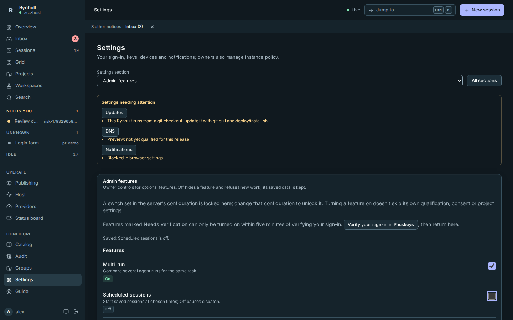
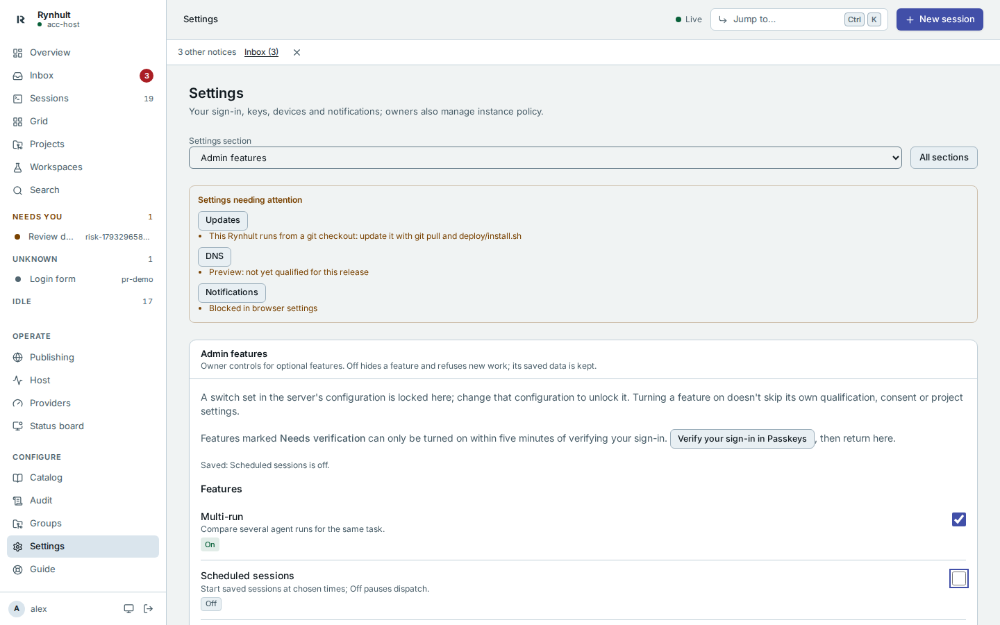
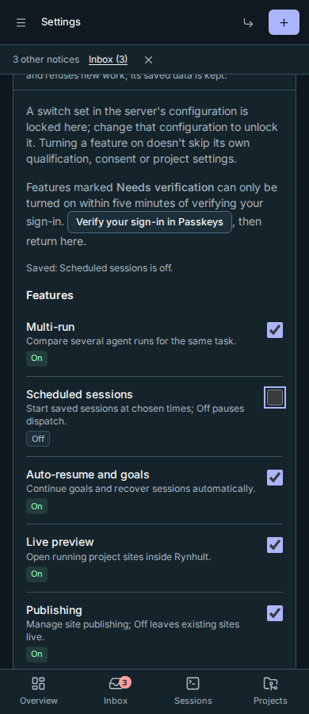
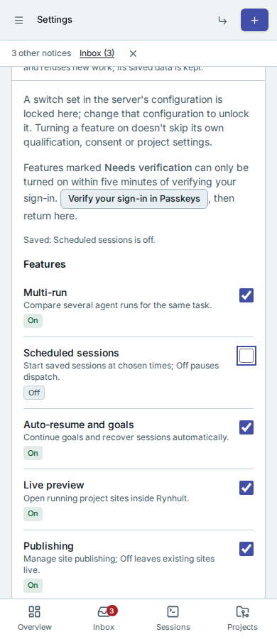

# Admin features

An owner opens **Settings → Admin features** to show or hide optional parts of Rynhult.
Each switch has an On or Off status. Previews also say **Preview**; containers say
**Needs qualification** until this host's checks pass, and switches that need a fresh
sign-in verification say **Needs verification** while they are off.

Off removes the feature's navigation, settings and launch controls. Its API refuses new
work too, so an old tab or an agent cannot keep using a hidden feature. Sessions,
terminal, Inbox, local sign-in, guardrails, backups, machines and the Guide remain available.

## Features and Previews

**Features:** Multi-run, scheduled sessions, auto-resume and goals, live preview,
publishing, issue sources (Linear and GitLab), groups, agent teams, telemetry opt-in,
local models, web notifications, change explanations, advisory risk labels and
Orchestrator v2 (on by default, not a Preview).

**Previews:** company sign-in, own-machine groups, containers per session,
direct public remote access and mobile enrollment.

Availability is separate from consent and configuration. For example, telemetry still
needs its sharing consent, public access still needs reviewed configuration and paired
devices, and container projects still need a qualified host and their own opt-in. Turning
on availability does not apply public routing or enroll a device.

## Keep your data

Turning a feature off keeps saved settings, history and project choices. Existing published sites remain live. Device revocation remains available even when public access is off, and so does revoking
group key grants, group machines and own-machine placements while groups are off. With telemetry
off nothing new is shared, but **Settings → Usage and bug reports** still offers **Delete data
already sent**, and deletion requests keep being sent. Schedules pause
new dispatch, and auto-resume and goals pause automatic commands. Existing ordinary
sessions continue and remain accessible through Sessions. Turning off agent teams, groups,
Orchestrator v2 or direct public remote access asks you to confirm first. Teams are stopped through the
normal safe stop path; offline helpers keep a stop request until their machine reconnects.
Public remote access closes public streams immediately; removal of external routing may
remain pending if its helper is unavailable. Use the private address for recovery.

Turning a feature back on restores access to its saved configuration. Paused schedules
follow their existing missed-run policy. Stopped teams require a new execution grant;
they are never silently restarted. Public access requires its existing review/apply flow.
An action already accepted before Off may finish; Off cannot recall sent text or revoke
a provider credential that has already been delivered.

## Server configuration and verification

A locked switch says **Locked** and **Set by the server's configuration**. An owner must change that
configuration to unlock it. Otherwise the saved Admin features choice takes precedence
over the feature's original default. Existing installations keep their original defaults.

Switches change only from an owner's signed-in browser, never with the installation API token.
Enabling company sign-in, own-machine groups, containers, Orchestrator v2, direct public remote
access or mobile enrollment requires fresh sign-in verification. Follow **Verify your sign-in in Passkeys**, verify
with the method required by your sign-in policy, then return within five minutes.
The switch cannot bypass a Preview's qualification, consent, pairing or project checks.
Every saved change is recorded in Audit. If another tab changed the panel first, the panel says so and reloads the current
state; review it before trying again.

## Panel examples

Desktop, dark and light:

Phone, dark and light:

