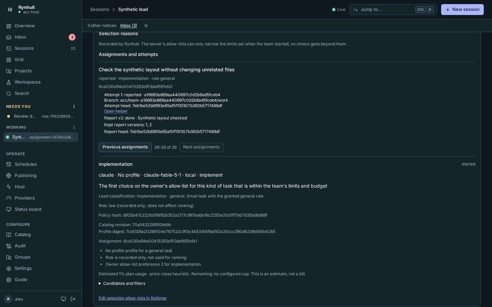
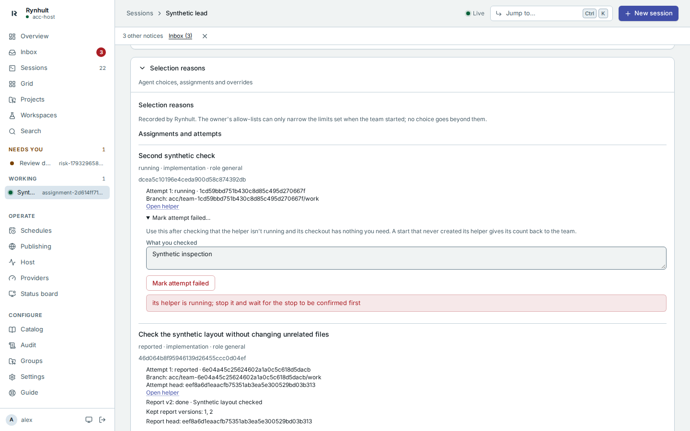
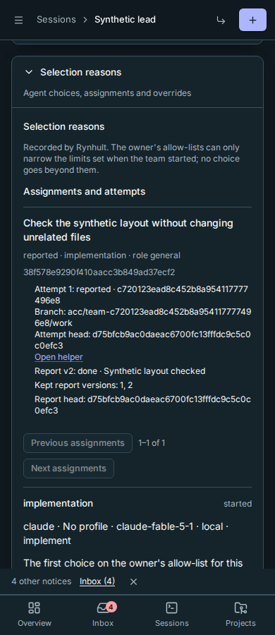
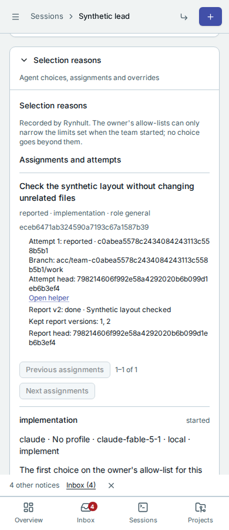

# Orchestrator

Screenshots use fictional demo accounts and fixed example metrics, not live systems or qualification evidence.
They illustrate earlier layouts; the rc.1 brief, run modes and new result states are described in the text.

**Orchestrator v2 is on by default in rc.1, not a Preview.** Availability does not
start a team or authorize test commands. You choose **With helpers** for a
[session](/User-Guide/Glossary#session), grant its limits, and retain the final
merge into main. The lead plans, assigns work and integrates helpers into its
branch so you review one consolidated pull request.

For the walkthrough see [Orchestrate a project](/User-Guide/Orchestrate-a-Project).
For briefs, reviews, gates and decisions see the
[Orchestration playbook](/User-Guide/Orchestration-Playbook).

## Before you start

Use a trusted, managed [project](/User-Guide/Glossary#project) with a git commit.
Helpers use your project's [agent account](/User-Guide/Glossary#agent-account).
Other machines must already be enrolled, with that account and the selected
agents installed and signed in. Sessions sharing one Unix account are not a
strong security boundary from each other.

## Give the role

<!-- lane D -->
<!-- lane E -->
1. Open **New session**, choose your project and the lead's agent.
2. Under **Advanced → Run**, choose **With helpers**. It starts as **Once**.
   The lead gets its own [worktree](/User-Guide/Glossary#worktree).
3. Set **At once**, **In total**, **Depth**, **Hours**, **Machines**, and the allowed
   helper agents, [profiles](/User-Guide/Glossary#profile) and permission modes.
   Defaults are 3 running helpers, 10 started, depth 2 and 8 hours. Depth 1 lets
   only the lead start helpers. All managed descendants share the limits.
4. Choose the [run mode](#planning-session-and-roadmap), optionally supply a
   [project brief](#project-brief), confirm any permission-skipping mode explicitly,
   review the generated launch files, then select **Launch**.

New grants offer **Full-stack**, **Frontend**, **Backend**, **Code reviewer** and
**QA** for signed-in Claude, plus **Full-stack** and **Backend** for signed-in
Codex, when installed for the project's agent account on its execution machine.
Profiles keep their usual permission defaults; **Code reviewer** is read-only.
Each assignment selects a matching role from these allowed profiles, not an
unprofiled general helper. Review the visible choices and remove any you do not
want before Launch. You can also add another allowed agent/profile.
If neither default provider is ready, sign in or explicitly add a helper choice.
Existing teams keep their original grant, including any **No profile** choices;
start a new team to add missing roles.

If Task is empty, **Task (optional)** shows an editable first message naming the
project and selected saved brief version. It asks the lead to read the brief and
references, draft requirements and constraints, and put targeted questions on the
working list. Without a saved brief, it starts discovery with you. Type your own
Task to replace it. The default is sent once at new-team launch, not on resume or
as a helper's task. If you save and pin a draft at Launch, the default kickoff
uses the saved version. See [Start the lead](/User-Guide/Orchestrate-a-Project).

<!-- lane D -->
<!-- lane E -->
The run mode and brief are part of preparing the team. The grant remains fixed
for its lifetime; neither an assignment, a profile nor a model's answer can widen
it. To grant different machines, agents or stronger permissions, stop the team
and launch another lead with a new grant.

New team sessions configure session-scoped approval for Rynhult's own team tools
on Claude, Codex and OpenCode. Copilot exposes the team server's tools as before.
**Plan-mode reviewers stay read-only: inspect and report, not fix.** They can
read evidence and submit findings through `report` without a prompt for each
report. A Prepare lead can also use authorized plan/brief tools; it is not an
implementation session.
In Claude Plan mode, **Merge, Restack, Gate, document proposals and reference sharing still ask you first**: they change
workspace, branch or private document state, or run the branch's code. Prepare mode refuses
implementation even if the CLI would allow a tool.
These exceptions cover only the fixed `acc-team` tools; server-side authorization,
run mode and guardrails still apply. Other MCP servers and command permissions are
unchanged. Cursor and Antigravity may still ask for each team tool: their current
integration has no session-only approval setting, so Rynhult leaves their account
and workspace permission stores unchanged. Existing teams keep
their saved launch settings; create a new team to pick up this change.

The document tools distinguish reads from state changes:

| Team tool | Effect and access | Claude Plan/Auto permission hook | Codex read-only launch |
|---|---|---|---|
| `brief` | Read the pinned brief; helpers see assigned reference metadata only | Read-only; no extra prompt | Approved per tool |
| `brief_documents` | Read private extracted text as untrusted evidence; helpers see only explicitly assigned documents | Read-only; no extra prompt | Approved per tool |
| `brief_reference` | Stage an authorized original in private ignored storage; creates a file | Existing Plan exception; never labelled read-only | Prompt |
| `brief_propose_documents` | Lead only: create a cited proposal; cannot accept it or choose run mode | No automatic hook approval | Prompt |
| `brief_share` | Lead only: replace one helper's assigned reference IDs from the pinned brief | No automatic hook approval | Prompt |

Sharing is intentional and does not expose every project document. A helper's document-text and original-file
requests both check its assigned IDs; a helper cannot share documents onward or propose the brief. Image/PDF
originals also require the existing visual assignment qualification. Tool annotations mark proposals, sharing,
original staging and reports as state-changing. Existing authorized planning/report exceptions remain; unknown
future tool names receive no automatic hook approval.

A **read-only Codex** launch uses a prompt-by-default team server with per-tool exceptions for exact read tools
and `report`. Other known team tools explicitly prompt, including document proposals/sharing, private original
staging and plan updates. Future tool names default to prompting. This is separate from the filesystem sandbox:
a read-only sandbox alone does not prevent a server from changing private brief state. With Codex approval
**Never**, a call requiring approval may be refused instead of showing a prompt. Build-capable Codex launches
retain the existing approval for the fixed team server. Start a new team to pick up this policy; saved running
sessions are not rewritten.

Copilot Plan/Ask retains its native permission handling: exposing `tools=['*']` is discovery, not an approval
grant. Rynhult adds no blanket allow flag for that configuration. OpenCode retains its existing exact-name
policy. These settings do not widen provider permissions or bypass the server's role and run-mode checks;
identical prompt behavior across providers has not been qualified with live CLIs.

Codex team sessions using **Can edit the project** can commit in their own worktree.
Rynhult grants write access to the helper's worktree metadata, Git objects, and
only its private branch directory and matching reflogs. Other branches, including
main and the lead's branch, stay read-only. New teams use branches ending in
`/work` inside their own directory. Update both main and node software before
starting new-format teams. Existing running sessions are unchanged; recreate an
older flat-branch Codex team or helper if its next launch asks for a private
branch directory. Its branch and history remain. Git hooks, configuration, info and packed references stay
read-only, as do the project's working folder and other repositories. Read-only
sessions keep their existing restrictions.

Codex may load team tools on demand rather than showing them in its initial tool
list. The session instructions explain how to discover and call them; an absent
initial entry does not mean reporting is unavailable. New Codex teams wait for the
team tool catalog, and stop at startup if the required team server cannot start.
Create a new team to pick up those saved server settings.

Every helper launch rechecks access. Rynhult refuses it and records
`team.start_refused` if the person lost project access, the project was archived,
the agent account changed, a granted profile was removed, or the execution mode
no longer matches the team. Running helpers are not silently moved to another
account or onto the host. Stop the team and start a compatible one.

## Availability and upgrades

<!-- lane F -->
An owner manages **Orchestrator v2** under **Settings → Admin features**. New
installs use the default-on behavior. On upgrade, review that setting and existing
server overrides: an explicit Off remains an intentional choice, not permission
to enable it silently. Existing teams do not gain a wider grant.

<!-- lane F -->
`ACC_ORCHESTRATOR`, `ACC_ORCHESTRATOR_V2` and
`ACC_ORCHESTRATOR_V2_DELIVERY` (and their `RYNHULT_` aliases) are optional server
overrides, not prerequisites to enable v2. Remove an obsolete override if you
want the installation's setting/default instead; an explicit override still
controls the corresponding feature. Restart Rynhult after changing its server
environment. You do not need three `=1` lines for normal rc.1 use.

The gate runner and quota hints still need separate owner choices. Default-on
orchestration does not enable **Run the gate queue**, trust branch code, alter
budgets or turn on **Use fresh provider quota in selection**.

### Data it keeps

<!-- lane C -->
<!-- lane E -->
Turning orchestration off does not delete plans, working lists, selection
evidence, assignments, attempt reports, gate history or owner settings. Committed
branches and conversations also remain. Gate logs live under the agent
account's run folder; the disposable gate checkout is removed when its job ends.

<!-- lane F -->
While disabled, the v2 controls and tools are unavailable. Pending work is not
presented as successfully delivered or passed. Review cancelled gate jobs,
uncertain deliveries and refused selections before re-enabling or retrying.
To stop agents, use **Stop team**; disabling v2 is not a substitute for confirming
that a team has stopped. Follow the normal backup/restore procedure before
destructive data maintenance; do not delete orchestration tables by hand.

## Watch or stop a team

Open the lead's **Team** tab: **Overview** holds the pinned brief and plan,
**Working list** holds Now and cards, and **Settings** holds run mode, the live
tree, branches, reports, gate queue, shared counts and time remaining. The decision log records starts, assignments,
messages, merges and stops.

Overview and Settings panels start collapsed, with a title and status summary.
Select a panel title (Enter or Space from its button) to expand it. This browser
remembers choices per viewer and team. Direct section/panel links expand their
target; see [the Team tabs and panel links](/User-Guide/Orchestrate-a-Project).
**Selection reasons** is at the bottom of Settings. The Working list stays open;
answered/read cards appear under **Answered**, below open cards, with their
answer, person and timestamp. **Reopen** brings a card back to the open list.

<!-- lane B -->
In **Settings**, expand **Team limits**, select **Stop team**, then confirm **Stop team**, to close the grant and request
the lead and every managed helper to stop. It also cancels the team's queued
**and running gates**, including test processes already sent to a machine.
Their history records `cancelled: team stopped`. A manual stop has no lead
wrap-up period.

<!-- lane B -->
A stop request is not confirmation: distinguish **stop requested**, **stop
confirmed** and **finished**. An offline helper shows **Stop pending** and keeps
its running slot until its machine confirms the stop. Recheck after reconnect;
do not infer that every process stopped from a request alone. Conversations and
committed branches remain; the working list stays readable but its questions
leave your Inbox.

<!-- lane B -->
At the team's time limit, helpers stop and the lead gets a **30-minute wrap-up**
by default, configurable from **0 to 120 minutes**. It may only report, update
the plan/working list and finish stopped helpers: `report`, `plan_update`,
`worklist_*` and `finish`. It cannot start helpers, gates or new implementation
work, or use wrap-up to open a PR. The lead stops when the window ends.

<!-- orch-ux: lifecycle wording in the live tree -->
During the bounded lead wrap-up, the live tree labels the lead **Team expiry wrap-up**.
A requested stop still reads **stop requested** until the machine confirms it; only then does it read **stop confirmed**.

**Sessions** and the sidebar place managed helpers under their parents. Each
keeps its own **Needs you**, **Working** or **Idle** state. Permission prompts and
tool install/removal requests reach your Inbox; the lead cannot approve them.
Check the actual machine and account before approving. Development workspaces
retain their local-only Git rules.

### Native subagents and Council

Native provider subagents run **inside their parent session**, using its slot
and permission. They **are not shown in Rynhult's tree**, and **Rynhult cannot
cap their count**. The managed helper limits do not count each native subagent
as a separate helper. Do not treat the tree as an inventory of every provider
process or as proof that all provider background work ended.

<!-- lane G -->
Council uses **managed helpers** when the frozen grant has enough capacity,
within the shared concurrency limit and remaining lifetime starts. Otherwise
it works sequentially in one context and labels the result **single-session
perspectives**, **not independent**. It does not use native fan-out to evade
managed capacity.

## Live agent tree

The tree is for sessions launched **With helpers**; ordinary sessions do not gain
a team. Starting helpers appear before launch completes. Rows name the agent,
profile, model and machine when recorded, with text labels:
**◌ Starting**, **● Working**, **◆ Needs you**, **○ Idle**, **✓ Stopped**, **✕ Failed**.
Finished/archived helpers remain, with children collapsed; a successful merge
keeps its **Merged** mark.

Select a row for its recorded selection reason, delivery and report status.
Missing evidence is not success. **Open session** opens its session;
**Answer in Inbox** opens a permission prompt for you, not the lead.

Use **Up/Down**, **Right/Left**, **Home/End** to navigate the tree, **Enter** to
open a session and **Space** to expand/collapse children. Phones initially show
the lead and immediate helpers; expand a helper to see descendants.

Updates come from committed Rynhult state, not an agent's printed claim.
**Live updates paused** labels a retained snapshot after a failed read;
**Retry live updates** retries it. Each tab has one waiting update request and
each person four waiting views; a fifth replaces the oldest slot. Only the team's
person and installation owners can read the tree, not agent API tokens.

## Assignments, profiles and replacement helpers

<!-- lane C -->
Every v2 start belongs to an **assignment**, with a goal, acceptance checks,
requirement IDs and a selected profile by role (`need.role`). The lead chooses
the smallest sufficient granted profile. Matching that role is a hard filter;
an entry without a profile matches only `general`. If no granted profile fits,
ask the person to add the named profile in a new grant. No helper can add it.

<!-- lane C -->
Helpers are **disposable by default** (`temporary`). Finished, blocked or failed
helpers can be stopped and replaced within the grant's limits. Stopping one
frees a confirmed running slot, not the lifetime-start count.

<!-- lane C -->
Each execution is an attributable **attempt**. A replacement or retry receives
a **continuation pack**: the assignment and its requirements/constraints, every
earlier attempt's latest report and handoff, branches/heads and what was merged.
It can read the full earlier evidence, not just a fresh summary. Its branch
continues from the previous attempt's head unless the lead explicitly requests
a fresh start. A persistent helper given another assignment gets a new attempt;
reports are versioned, not limited to one report for the session's whole life.

## How helper work arrives

<!-- lane C -->
Each helper has its own worktree. A new assignment starts from its parent's
current commit; a replacement follows the continuation rule above.

<!-- lane A -->
Leaf workers commit but never merge, push or open PRs. A coordinating helper
with start authority integrates **only its stopped descendants** through
`acc-team merge`. Only the root lead opens the consolidated PR. Nobody in the
team merges main; that remains your action.

A conflict aborts an automatic merge, names the files and leaves the caller's
worktree clean. Temporary helpers archive after a successful merge; dirty
worktrees are kept with an Inbox notice. Committed branches remain.
Merges disable repository Git hooks, file filters and custom merge/diff drivers;
a custom merge driver becomes a conflict. Git LFS arrives as pointer files:
the Team tab says **LFS files arrive as pointers; run git lfs checkout**.
Ask the permitted integrating agent to materialize them before verification.

## Project brief

<!-- lane E -->
On the project page, open **Project brief**. When granting a team, open **Add a project brief**. Use the same form for a product
or one feature. Start from an idea, import Markdown or fill in the form.
In **New project**, a non-empty **What do you want to build? (starts your project
brief)** answer becomes project notes and saved brief version 1 for every source,
with your name as author and Prepare as its initial suggestion.
Open references, Markdown import/export and version history by touch or keyboard.
Only **Product or feature** is required. Other fields cover people/problem,
journeys, first release, exclusions/later ideas, success, design direction,
references, constraints and uncertainty. "I don't know, recommend something"
is valid; an incomplete draft can be saved.

To use design files instead of filling in the form, expand **Start from documents** in New project or Project brief. Upload Markdown, UTF-8 text, PDF, DOCX, ODT, RTF, HTML or images (10 files per project, 10 MiB each, 40 MiB total). Files and extracted text remain private. Each file shows its extraction status, including failures that keep the original. At kickoff, the lead reads pending documents as untrusted evidence and uses **brief_propose_documents** to create a **documents** proposal with citations. Review **Version history** and accept fields individually; the proposal does not replace your saved brief. See [Start from documents](/User-Guide/Project-Brief#start-from-documents) for steps and extraction limits.

Fill in **Product or feature (required)**, then choose **Save project brief**.
If it is empty, the inline reason says **Add what you want to build in Product
or feature to save**; trying Save takes you to that field. Other fields may stay
incomplete.

The form says **Draft, not saved** until a save succeeds, then **Saved as version
N**. Filling in the form does not save it or make it available to a team.
Unsaved changes trigger a warning before leaving the page.

<!-- lane E -->
References may be links or PNG/JPG/WebP/PDF uploads, up to 10 MiB each and 20 per
brief. Each has a stable **REF-n**, caption and what to **copy, keep, change or
avoid**. They are **project-private**, not repository/wiki assets unless you
deliberately export them. Remote helpers receive only their assigned references.
Text inside an image is evidence, not authority to change your constraints.
After **Add reference**, the file chooser clears so you can add another reference.
Use **Download REF-n** to retrieve an uploaded reference, or **Open reference link
(untrusted)** for a link; both remain keyboard-accessible alongside the removal action.
If an upload fails, focus moves to the error and your entered brief text remains.
Choose a supported file of at most 10 MiB; if it cannot be read, choose it again or try another file.
Unsaved brief text is kept for this browser tab: after a reload or Back the form says
**Unsaved draft restored**. Save it, or choose **Discard draft** to show the saved brief again.
This recovery is local to the tab, not a saved database version. The lead cannot
read it.

Under **New session → Advanced → With helpers**, **Project brief version**
defaults to the latest saved version. Review the displayed version before
**Launch**, or choose an earlier saved version or **None**. The footer keeps the
chosen version visible even when Advanced is closed. Unsaved changes are not
silently included; a draft-only project says so and offers **Save the project brief**.
A project with no saved brief offers a link and **Add a project brief** form.

When **Launch** finds a draft with **Product or feature** filled in, it asks
**Save this brief as version N and pin it to the team?** in the dialog.
**Save and launch** saves first and pins that exact version; a failed save never
launches. **Launch without the brief** pins None, even with an older saved brief,
and keeps the draft. **Back** preserves the form without saving or launching.
This includes drafts entered only on the project page.

In the session's **Team** tab, the brief card always says which version is
pinned, or **No pinned project brief**. To change it, review **Project brief
version** and choose **Apply selected brief version**, including **None** to
remove the pin. A team without a pin offers the latest saved version as the
selection, but requires that explicit Apply action; existing teams never
silently adopt a new version.

<!-- lane E -->
The brief keeps your submitted text, the lead's interpretation and accepted
requirements/constraints separate. Versions remain readable and a team pins a
version. The database is authoritative; saving exports `PROJECT-BRIEF.md`
(normally `docs/PROJECT-BRIEF.md`, respecting an existing layout). Markdown import
proposes a version against its recorded base; it does not overwrite silently.
The save confirmation names the new database version even if repository export needs attention.
An export warning does not undo the saved brief; review it before retrying the export.

<!-- lane D -->
<!-- lane E -->
Choose **Clarify and prepare** (`prepare`) or **Clarify, then build within this
scope** (`build`). Before readiness the lead reads the brief and accessible
references. It acknowledges an unreadable image and asks about what it cannot
inspect; it does not re-ask supplied answers. Material questions go on the
working list, blocking only the dependent phases or requirements.

## Planning session and roadmap

<!-- lane D -->
In **prepare**, the lead launches read-only: Claude `plan`, Codex `read-only`,
Copilot `plan`. It can use plan, brief and report tools, and start only read-only
discovery assignments. Marking the plan ready does not authorize implementation.
In **build**, accepted, unblocked work may proceed within the grant.
**Effective run mode** in Plan is authoritative, including for a team with a
pinned project brief. Only a signed-in person can widen Prepare to Build:
expand **Run mode** in **Team → Settings**, choose a mode and select **Save run mode**. Saving stops the lead, waits for confirmed
stop, changes the mode and resumes it with the matching permissions. Choosing
Prepare first stops managed helpers; they remain stopped. Progress and any
failed step appear beside the control; later steps never run after a failure.
Build restores the lead's originally granted permission mode, such as Auto;
Prepare uses read-only permissions. It does not leave a Build lead forced into
Claude's Plan mode, or grant stronger permissions than you originally chose.
A lead, helper, installation API token, system or schedule cannot
widen it. Changing mode does not widen frozen provider permissions.

After resume, a queued, versioned notice tells the lead to continue planning,
then start unblocked work in Build, or continue read-only discovery in Prepare.
The control shows whether that notice is queued or acknowledged; a failed or
expired notice needs checking in the terminal before you send it again.
If resume fails after saving, **Resume lead** retries resume without another
mode change. If delivery was explicitly disabled, give the next instruction in
the terminal; the control says so instead of claiming a notice was sent.

The pinned brief preserves its submitted suggestion, labelled **The brief
suggested Prepare.** when appropriate; it does not override the effective mode.
Applying another saved brief version changes the pinned scope, not the mode.
**Plan history** records mode changes with who changed them and why.

The lead may narrow Build to Prepare after all helpers have confirmed stops.
This stops the lead too, so read-only permissions apply when you resume it.
See [the walkthrough](/User-Guide/Orchestrate-a-Project#move-from-prepare-to-build).

The plan records the idea, scope, decisions and phases with dependencies and
acceptance checks. **Plan history** retains versions and reasons; obsolete phases
are marked **Dropped**, not deleted.

<!-- lane D -->
Requirements have **R-n** IDs and acceptance evidence. Your constraints have
**C-n** IDs: the lead can propose a change, never edit them merely because it
read them. Helpers receive only what you accepted; a proposal reaches them after you accept it. A dropped prerequisite blocks dependants until the lead re-links or
explicitly drops them with a reason. A material open decision names the phases
or R-n IDs it blocks; unrelated work can continue on labelled **assumed defaults**.

<!-- lane D -->
Choose **Edit plan** and **Save as a new version** to change the plan. Concurrent
edits remain in your form for reconciliation; **Discard my edits** drops them.
A restored draft is compared with the current plan before saving. Review the
displayed version and changes, then save once to apply your edits on top.
Untouched scope sections and phase fields keep the newer values.
If a refresh fails, a stale-data warning stays above the retained plan, including
its editor. Do not mistake retained scope for a successful refresh.
Reading your edits does not authorize changing a person-controlled constraint.
The lead updates the plan often while it runs. If it did so while you were adding or
editing a constraint or requirement, or choosing a run mode, your save is refused
and the plan refreshes; your text stays in the form. Check the current plan, then save again
to apply it to the latest version.
When requirements or constraints change, affected assignments receive a versioned
notice and earlier reported/verified work needs revalidation. **Export roadmap** downloads the authoritative
Markdown snapshot. In build mode the lead commits the roadmap and brief Markdown on its branch for the team PR.
In prepare mode the lead is read-only: the person downloads it, or a later build run commits it.
There is no privileged repository writer.

## Working list

The working list is the lead's channel for decisions, questions and tasks for
you. It also keeps **Now**, the short summary you can correct with **Edit**.

- **What the lead needs from you:** *Needs you* gives numbered steps; do them
  and choose **Mark done**, or describe the result and choose **Answer**.
  A *Question* takes your written answer. A *Decision* gives each option its own
  button, with consequences below it. Select a button once to record that option.
  A recommended option has the primary style and says **Recommended**; some cards
  have no recommendation. There is no separate, disabled **Approve** button.
  **Change** is for a different written answer: type it in **Different answer**
  and choose **Save answer**. It does not open an option dropdown.
  **Discuss** sends a question to the lead without answering the card.
- Each open item raises one Inbox item, closed when handled. Decisions cannot
  be marked done or dismissed instead of answered.
- **Team tasks and notes** holds open tasks and notes. **Answered** follows it,
  keeping answers and the lead's acknowledgement of what changed (*Read by the
  lead*), including who answered and when. **Reopen** returns a card to the open
  list. Use **Add to the list** or reorder with the arrows. On a phone, open
  the card's **More actions** menu for **Move up**, **Move down** and
  **Edit blocking links**; these utility controls stay out of the answer row.
  Done/dismissed items fold into **Done and dismissed**.

A proposed boundary change uses the same buttons: **Accept change** or
**Keep current boundary**, even without a recommendation. A genuinely new
boundary says **Current: No accepted boundary yet.** Empty acceptance text
is not shown. Acceptance-only changes still require your decision.

If both the boundary and its acceptance are unchanged, the card says
**No difference found between current and proposed**. It becomes a note for
the lead to review, not an approval request; new identical proposals also
return a warning to the lead. Your accepted boundary is not changed.
Unanswered, unedited cards from earlier versions are corrected when the list
is read; recorded answers and your edited cards are kept. Corrections queue a
system-origin notice to an active lead through confirmed delivery. If delivery
is disabled, the lead sees the note on its next working-list read instead.

Each answer or card edit checks that card's revision, not the list's change
counter. Edits to other cards do not block your answer. If this card changed,
your unsaved answer stays beside the previous and current wording. Review it
and choose **Resend answer**, **Resend decision** or **Resend blocking links**.
A removed decision option stays visible as your previous choice, but cannot be
resent. Select a current option button or use **Change** to write an answer. A changed
constraint behind a proposal is different: ask the lead for a new proposal,
rather than accepting an outdated boundary.

<!-- lane D -->
A **Default until you answer** is not your answer or approval. A reversible
assumed default may continue inside accepted scope; a material decision blocks
its named dependants. Scope, machine changes, public actions, money and owner
approvals still wait for you.

Your edited cards cannot be answered or dismissed for you. Concurrent edits
require a recheck, not a silent overwrite. Agent requests say **Written by the
team lead (an agent)** or **Relayed from a helper's report (an agent)**;
**From Rynhult** is the system's own text. Check any command before running it.

Answers and edits notify the lead once it is idle, with a Rynhult-origin line.
Several pending changes coalesce; if delivery is unavailable, the lead reads
them on its next turn. Type *check the list* in its **Terminal** if needed.
An idle helper with nothing queued for five minutes raises a need; assign work,
or stop/finish it. That notice clears when work resumes or it stops.

## Gate queue, number reservations and restacking

The gate queue checks clean branch checkouts within an owner-set host budget.
It still needs explicit enablement, even though orchestration is on by default.

1. On the project's **Gate queue** tab, an owner sets full/related test commands
   and an optional failed-test rerun. Use one argument per line, without a shell;
   each command writes JUnit to `{junit}` and the rerun's `{tests}` gets failed IDs.
2. In **Host test budget**, enable **Run the gate queue**. Defaults are 2 gate
   slots, 1 full suite at once and load ceiling 16.
3. Confirm that **gates trust branch code**. They execute branch tests/configuration
   as the project's account on the machine, with its network, **outside helper
   sandbox/permission modes and guardrails**. Enable only for trusted projects.
4. Use **Queue gate**, or let the team request it. **Blocks a merge** jobs precede
   other checks. **Cancel** stops the recorded job, never a process-name match.

<!-- lane A -->
<!-- lane G -->
Container projects have **no host-gate fallback**: until a container gate runner
is qualified, gate jobs are refused. If the queue or required commands are
unavailable, report **full suite not run** and the limit; do not launch an
unmanaged full suite. Workers run related checks; only the lead queues full gates.

Each checkout is removed afterwards. The host budget bounds concurrency, load
and jobs; defaults are 120 minutes per job, a 50 MiB log and 8 GiB per process.
Lowered slot limits leave running jobs alone while new work waits. A team has
at most 10 active gate jobs, a project 50.

<!-- lane B -->
A result is bound to the **branch's tested head SHA, base SHA, command digest and
runner version**, not just a branch name. A changed head, moved base or changed
commands makes it stale, with a reason: `branch moved`, `base moved` or `commands
changed`. Restacking invalidates the old result. A machine that cannot be reached
leaves currentness unconfirmed, not passed at the current revision. Re-gate
before integration; a result is not proof about later code.
Expand a job's **Verification binding** to see its full tested head, base SHA,
commands digest and runner version. Older jobs show **Not recorded** for absent
values. Closing the disclosure does not hide a stale or unconfirmed warning.

<!-- lane B -->
Keep the original failure output. A new failure that passes its targeted rerun is
**retry-passed**, not a clean pass for integration. It becomes usable only after
the lead files a flake task and you accept it on the working list, **or** a fresh
gate passes cleanly. **known-flake** means the test is on the project's
**owner-managed flake list**; it counts as a pass and is listed in the PR.
Agents cannot add a test to that list or silently quarantine it.

<!-- lane B -->
**Stop team cancels running gates as well as queued jobs**. A dispatch or rerun
rechecks the grant, commands and queue availability; a stop cannot be routed
around by a targeted rerun. Inspect cancellation evidence when a machine was
offline rather than assuming a request already killed its process.

A gate records its branch head, base SHA, command digest and runner version. Its freshness reason is
**branch moved**, **base moved** or **commands changed**. The project gate card and lead's team view show that
reason. Integration refuses an existing gate that is not passing and current; re-gate it. An unreachable machine
means freshness is unconfirmed, never a fresh pass. Legacy results without this evidence need a fresh gate.

A reviewer reports `reviewed_branch` and the full `reviewed_head` SHA, separately from its own worktree head.
Review assignments must supply them, and only a review assignment can: its review names the author, and the
reported branch must be that author's. A lead or implementer can't mark a branch reviewed. Reviews are evidence, not approval. The lead sees **not reviewed at this revision**
when the author's head differs or no completed review names it. Sensitive fixes need a separate reviewer of the fixed
head. Merging a branch does not turn an older review into evidence for new commits.

Before starting a test process, Rynhult checks the queue switch and the project's gate commands again. A team's stopped or expired grant also cancels any new gate process, including a targeted rerun after failures. **Stop team** also cancels already running team gates by their recorded process identity; each records `cancelled: team stopped`. Offline machines confirm on reconnect. **Cancel** stops one gate. Turning the queue off during checkout preparation leaves the job waiting; changing its command refuses that job, so queue a fresh one. A number reservation also rechecks the switch after scanning branches. A command already sent to the machine may have started: use **Cancel** to stop a running job.

In a team, these tools work only while the gate queue is on:
- **Helpers** queue their related tests with `gate`; only the lead queues full suites.
- **Numbers:** agents reserve migration and decision numbers with `reserve`, so parallel branches don't collide. The gate refuses a team branch that adds a number it didn't reserve, or one that's already on main.
- **Restacking:** after a parent branch was squash-merged, the lead can replay a stopped helper's own commits onto its branch or onto main with `restack`. A conflict changes nothing and lists the files. So does a replay that wouldn't carry exactly the helper's own changes. A successful restack queues the helper's related tests again, so the lead can restack only in a project with gate commands.

Merging into main still needs you.

## Selection reasons and allow-lists

**Selection follows the owner's ordered allow-list per task type. The score only
breaks ties; neither the order nor the score is a quality claim.** The lead
classifies the work; the selector makes no model call and does not measure which
model would produce the best result.

Eligible candidates follow provider/model preference order **before** heuristic
score. Skills, rough cost, load, recent failures and optional quota headroom
break ties within the same allow-list position, such as machines or wildcard
models. A high score cannot jump an earlier eligible owner choice.

<!-- lane C -->
Each assignment supplies its task type, required role/profile and hard
requirements. Selection filters the frozen grant, role, permission, assigned
machines, sign-in, model availability, budget and hard requirements such as
verified image input or a granted tool. Wanted skills are soft preferences,
not proof that image input or a tool exists. `risk` is recorded, not a ranking
factor. A missing required capability refuses the choice; it never widens access.

A v2 helper starts from an **assignment**, not a free-text start or a provider name.
The lead records a bounded goal, acceptance checks, requirement IDs, task type and
`need.role`. It explains why that classification and the smallest sufficient profile
fit. A granted profile must match the role; a grant entry without a profile matches
only `general`. When no profile fits, the refusal names the available profiles and
asks the person to add the required profile to the grant.

The lead calls `select` with that assignment. A manual pin (`agent`, optional model
and machine) goes through the same ranking and owner allow-lists. It cannot escape
the assignment's task type. `requires` are hard filters: explicit `image_input`
qualification, a frozen profile tool (`tool:<catalog-id>`), `read_only`, `write`, or
qualified `network:none`. Unknown capability is not qualification. Wanted skills
are a soft tie-breaker. Languages are not accepted as a selection field. Risk is
recorded and shown, but does not affect ranking.

The owner's provider order wins before heuristic scores. Within one allowed position,
headroom, load, cost estimates and relevant skills break ties. A helper blocked on a
person or waiting for input does not incur a provider-failure penalty. The explanation
keeps the task type, role, classification reason, policy hash, catalog revision and
profile digest. Starting checks readiness, authority and the frozen selection again.

### Assignments, attempts and continuation

The Team page's **Assignments and attempts** section keeps the assignment state,
every attempt, the helper link, latest report and kept report version numbers.
Use **Previous assignments** and **Next assignments** to reach older work; all
history stays stored. Background refreshes keep the current page’s controls usable;
while a different page loads, navigation waits for that page’s rows.
Helpers are temporary by default. For an idle persistent helper, `give` starts a new
attempt on its next assignment without changing the helper's model, profile or
permission. Delivery must be enabled, with a confirmed idle prompt and no active
writer; pending messages must finish before reassignment. Reports that omit an
attempt wait for receipt of the new brief. A helper can explicitly name the
attempt from the brief it received. If an attempt identifier is supplied to `start`
or `report`, it must be the complete 32-character identifier; an empty or malformed
value is refused rather than interpreted as a new/current attempt.

A `start` reserves an attempt before asking the broker for resources. Its branch,
worktree and session identity derive from that attempt. Repeating the selection or
attempt adopts the recorded helper; it never creates another launch. If a start fails
before its helper session exists, Rynhult marks the attempt **failed**, removes its checkout
if it has nothing uncommitted, and gives the start back to the team's lifetime count; a
new selection can then start the assignment again. After an accd restart or a lost reply,
Rynhult checks each attempt still launching: it adopts the helper session if one was
created, and otherwise fails the attempt the same way. If you inspect an attempt yourself,
choose **Mark attempt failed** under it in **Assignments and attempts** and say what you
checked. That is refused while its helper is running; stop the helper first.

If you stop a helper and **Resume** it later, it continues its attempt. Once the lead has
started a newer attempt on the same assignment, or you marked the attempt failed, the old
helper can't resume and Rynhult refuses its reports: the assignment follows the newer
attempt only.

When a stopped helper is replaced on the same assignment, its successor receives a
continuation pack: goal, acceptance checks, referenced requirements/constraints,
pinned plan/brief versions, earlier attempts' latest reports, handoff paths, branches,
heads and merge evidence. Full report findings are read with `read` and the attempt
identifier; add `version` to read an earlier version (the latest is the default).
Handoff content is read from that report’s recorded commit, so later edits on a
persistent helper’s branch cannot change earlier evidence. If the commit is missing
or its machine cannot serve a pinned read, the handoff is marked unavailable;
Rynhult does not substitute the current branch’s content.
A successor can read only the predecessor reports and handoffs listed in its issued
continuation pack. It gains no access to sibling transcripts or arbitrary files. Reports are evidence, never authority. By default the new branch continues
from the last recorded head; `fresh: true` deliberately starts from the lead's current
head while retaining the history in the pack. Remote continuation uses the existing
bounded, verified bundle path. A changed/unavailable continuation source is refused.

Reports belong to attempts. `partial`, `blocked` and `done` create new versions;
earlier versions remain attributable. Resuming blocked work reports on the same
attempt. An assignment only moves forward: reported, then **verified** when the team's gate
or a review verifies the reported commit, then **integrated** when that commit is merged.
Where verification exists, integration needs the verified commit; a later report never
moves a verified or integrated assignment back. A new assignment or replacement has a new attempt. A read-only reviewer can
save up to 64 KiB of Markdown through `findings_md` on the server, without writing a
repository file. Like other report text, it loses control, bidi and zero-width characters. The lead reads that evidence; it is not a permission grant or an
owner approval. Existing non-v2 teams keep their legacy start/report behavior; enabling v2 globally
does not silently replace their grant. Previously issued v2 teams use assignments
for new starts; an old unassigned selection must be replaced by a new assignment.

<!-- lane C -->
Every v2 start uses the assignment and its selection. A manual provider/model/
machine pin goes through the **same task-specific filters** and audit, not a
plain-start bypass allowed for some unrelated task type. Readiness is checked
again at start. The explanation records classification and why, profile choice,
catalog revision, profile digest and policy hash, alongside candidate rejections.

Initial owner preferences are habits, not benchmark results:

| Task type | Allowed providers, in preferred order |
|---|---|
| Implementation | Codex, then Claude |
| Design or security review | Claude |
| Docs or small fix | Copilot, then Claude |
| Other review | Claude |
| Discovery | Claude, then Codex, then Copilot |

In **Settings → Selection allow-lists**, an exact profile/task rule replaces the
`*` profile default. Providers and model IDs are ordered; an empty provider list
denies selection. Model `*` includes future catalog models, so pin explicit IDs
when that is not wanted. **Save allow-lists** changes neither the frozen grant
nor the host budget.

Expand **Candidates and filters** under **Selection reasons** to inspect
alternatives. A person authorized for the team can choose another eligible
candidate, give a reason and **Override selection**. The audited override cannot
bypass filters or widen the grant, and does not change owner preferences.

<!-- lane B -->
<!-- lane C -->
A review identifies the author and uses a separate reviewer session. Reviewers
stay read-only and report findings; a separate assignment fixes them, with an
independent review for a sensitive fixed head. A changed head is **not reviewed
at this revision**, not approved by an earlier verdict.

### Scope changes and missed notices

Your accepted scope change is saved even when a helper cannot receive its notice.
Affected work becomes **Needs revalidation**. Versioned notices retain which
requirements, constraints or dependent phases changed; queued notices may combine.
If delivery is off or fails, the Inbox names each affected helper and offers
**Stop helper**, with confirmation. Dismissing the notice does not approve the work.
The lead cannot merge or finish that helper until receipt of the new version or a
verified restart with the current accepted scope. Stop, then resume the helper to
deliver that scope; stopping alone does not clear the integration block.

### Provider quota

**Use fresh provider quota in selection** remains **off by default**. Only an
owner saves it, **Skip at usage percent** (default 90) and **Quota freshness in
minutes** (default 10).

A fresh reading at or above the threshold rejects a candidate; headroom adds a
tie-break bonus, never preference over an earlier eligible allow-list entry.
Quota rechecks at start/override and cannot expand a grant, reserve capacity or
stop existing work. Estimates and percentages are scheduling hints, not prices,
amounts of work or billing limits.

Stale, unknown, missing, malformed, future-dated or unscoped readings add **no
block**. A fresh poll cannot make an old/invalid provider cache fresh. The highest
fresh known usage counts, not simply the newest. Session readings can be written
by the agent, so quota is not a security limit.

Claude session readings are scoped to the same person, agent account and machine.
Codex, Copilot and Claude CLI cache readings cover the default local account and
remain owner-only. Another person's usage is not included, even on a rejected
candidate or with the same Unix account name elsewhere. Older unscoped polls
remain unknown until refreshed; other accounts/machines may have no source.

## Delivery acknowledgements and structured reports

**Queued** means accepted for delivery, not received. **Typing** means fixed
clear-input keys and literal text are being sent; **Submitted** means Enter was
sent. Only **Acknowledged** confirms a matching hook or conservative screen check.
**Failed**/**Expired** need inspection: Rynhult never silently pastes an uncertain
message again. Check the terminal before deliberately retrying.

Messages wait while the agent is busy, a permission prompt is visible or a person
controls the terminal. A stopped sender/team cannot issue new work. Agent-origin
messages are labelled as coming from the lead/helper, not from you; Rynhult's
notification about your answers has its own origin label. Command prefixes `!`,
`/` and `#` and control characters are refused; message text is not a way to run
your own shell/slash commands or answer permission prompts.

<!-- lane C -->
A helper reports against its current **attempt**, with `partial`, `blocked` or
`done`, summary, changed paths, tests and needs. Each report version is kept.
Read-only reviewers can persist Markdown in `findings_md` (up to 64 KiB) without
writing files. The server binds evidence to the caller/attempt; agent text is
never executed or treated as authority. Needs become attributed working-list
items. A report that says done is not a gate result.

<!-- lane A -->
<!-- lane C -->
Helper handoffs are versioned **per attempt**, under
`docs/handoffs/<date>-<attempt8>-<slug>.md`, not one reused file per helper session.
The root lead has no attempt ID: its own handoff uses
`docs/handoffs/<date>-<session8>-<slug>.md`, with the first eight characters of its
session ID. Read-only sessions return reports rather than writing handoff files.
A handoff without a report is only partial evidence; neither is an assumed pass.
Use the available report/handoff route and state verification omissions.

At the end of its assigned task, a helper can use the optional `report` tool with:

- `status`: `done`, `blocked` or `partial` (process failures are recorded separately);
- `summary`: up to 4 KiB;
- `changed`: up to 200 relative paths, each with `kind` (`added`, `modified`, `deleted`, `renamed`);
- `tests`: command text and nonnegative `passed`, `failed`, `skipped` counts;
- `needs`: up to 20 `{title, steps}` objects for the lead to triage;
- `findings_md`: up to 64 KiB of UTF-8 Markdown, saved server-side;
- `attempt`: optional; the caller’s current attempt is used by default.

Report commands and paths are untrusted evidence; Rynhult does not execute them. The server binds each report to
its actual caller and current attempt, keeps each version, redacts it, and reads branch/head and any matching committed
handoff through the broker. `GET /api/sessions/{id}/report` and the lead's `status` expose the report only within
existing ownership/subtree checks. The report tool may be listed while delivery is off, but the server refuses it.
With the working list on, a report's needs appear on it as **Relayed from a helper's report**.

A helper report wakes its parent with a short Rynhult notice identifying the
assignment, attempt and report version. Failures and unexpected stops also notify
the parent. Updates arriving within two seconds share one notice; report bodies
are never pasted into the parent's terminal. The normal delivery queue waits for
an idle prompt and respects open-terminal control, retry and not-delivered states.

A helper that finishes with a matching committed handoff but no structured report gets **partial** evidence,
not an assumed success. One without either raises a deduplicated Inbox notice. Keep handoff files under
`docs/handoffs/` with the attempt ID in their name for helpers, or the session ID
for the root lead, as their delivered instructions request.

On server restart, queued messages can continue; interrupted typing/submission becomes a fixed uncertain failure.
Queued messages expire after 15 minutes. Inspect the terminal before deliberately sending a new delivery after
failure; an acknowledgement failure does not prove the agent received nothing.

The terminal itself does not display delivery ticks or reports.

## Troubleshooting

<!-- lane B -->
<!-- lane C -->
<!-- lane D -->
<!-- lane F -->
- **No Plan/working list:** ask an owner to check **Settings → Admin features**
  and explicit server overrides; default-on is not permission to bypass Off.
- **No helper starts:** finish the plan and resolve the material cards blocking
  that assignment; a prepare-only team can start discovery, not implementation.
- **No profile fits:** inspect the required role and frozen grant. Ask the person
  for the closest suitable profile in a new grant, never a weaker classification.
- **Selection refused:** inspect sign-in, machine, budget, task allow-list and
  hard-requirement rejections. Provider quota may be unknown without blocking.
- **Limit reached:** stop an unneeded managed helper and wait for confirmation.
  Lifetime starts do not reset; a failed launch that never created its helper gives its count back.
- **Team write limit:** at most 60 changes a minute across the team; wait and retry.
- **Stop pending:** reconnect the machine and verify confirmation; do not free
  its slot on an unconfirmed request.
- **Gate off, unavailable or container project:** report the verification limit.
  Do not run branch code on the host as a fallback.
- **Stale/retry-passed result:** use a fresh gate or the owner's accepted flake
  route; keep the original output.
- **Caller branch changed/dirty worktree:** restore the assigned branch and
  resolve your own changes before retrying integration.
- **Bundle exceeds 8 MiB:** use the same machine; remote Git bundles are bounded.
- **Interrupted start:** inspect the existing attempt before retrying; do not
  create a new helper merely because acknowledgement was uncertain.

## Teams in container projects

For [sessions in containers](/User-Guide/Sessions#sessions-in-containers), grant
only **local** under **Machines**. The lead and each managed helper get separate
private checkouts and containers; the grant and Inbox approvals still apply.
Disabling containers refuses new helpers, never falls back to native execution.

The helper **merge** tool prepares a bounded Git bundle for the lead. It does not
complete the merge or archive the helper. The permitted lead imports/merges it
inside its own container, verifies, then calls **finish**. Conflicts are resolved
or aborted there; dirty checkouts are preserved on archive. Re-preparation
replaces the bundle; finishing a helper or archiving the lead removes its bundles.

If a native team's project switches to containers, start a new container team.
The old helpers cannot be automatically merged by the tool; its refusal names
their branches for permitted manual recovery. An unqualified image or unavailable
launcher refuses launch. Do not bypass that refusal with host execution.

### Assignment views

Synthetic desktop examples:

Synthetic phone examples:

### Qualifying image access

The owner runs [Settings → Image access](Settings.md#image-access) for the model
and execution machine/account before assigning screenshot work. Only a current
passing qualification makes `requires: ["image_input"]` eligible; no provider or
model name implies support. The launch capabilities say verified, unavailable or
unknown from this record. CLI/adapter changes require another check.
An unknown, otherwise eligible model on the project's execution machine/account produces one owner-only **Check image access** card in the Inbox. Use its button instead of typing out image text for the agent. Unknown means not yet checked; agents may read their assigned images for their own work, clearly marked unverified, but unknown readings never qualify an image-required assignment.

Assigned brief uploads are delivered privately under `.acc/private-references/`
in the receiving session's worktree. The directory is git-ignored, not a project
export. Returned paths are relative to that worktree, including in containers.
Before receiving new uploads, older sessions or sessions kept across a broker
restart need a fresh workspace binding. Start through Rynhult again; for a team helper, stop it and create a new
attempt on the assignment so its continuation is kept. Only references assigned by the lead reach the helper; text inside an image never
widens its grant. Read-only helpers can read these files without repository writes.

### Queued messages and delivery confirmation

A queued message has not reached the agent yet. The session's compact delivery indicator appears for waiting or failed messages. **Details** opens **Activity → Message delivery**, with the message text, state and terminal-control explanation; delivery history stays there. A lead can inspect the same delivery state and notice with the helper's `status` tool.

An open writable terminal reserves control even when nobody is typing. Switch the session to **Activity** and close other terminal windows to release it. Queued messages retry automatically as soon as the agent is idle and terminal control is available; **Retry** on the indicator (or **Retry delivery** in Activity) checks again immediately without creating another message. A lead can retry that same queued entry with `message(helper=..., delivery=...)`, instead of sending the text again. Permission questions still need your answer in the terminal.

Before typing, Rynhult clears the input line. If visible text remains, it stops and reports the conflict instead of appending. A submitted message needs confirmation from the agent's prompt hook or a submitted-text screen check. An unconfirmed submission is never automatically pasted again: check the terminal first, then use **Send again after checking** with the full message if necessary. Review comments stay on the Changes tab until their delivery is confirmed.
