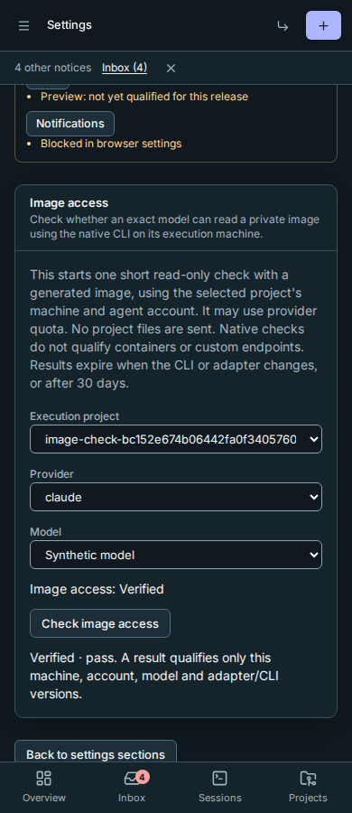
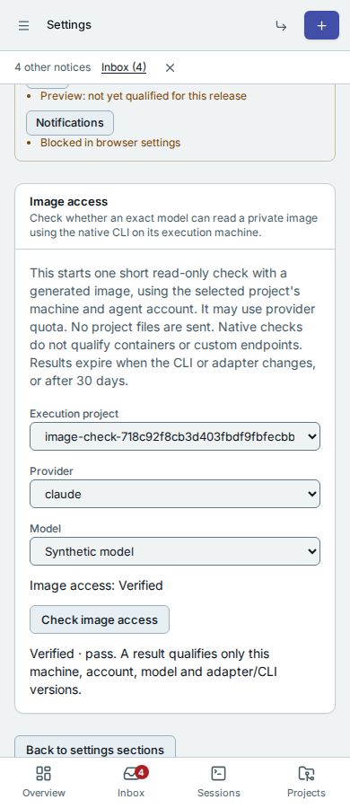
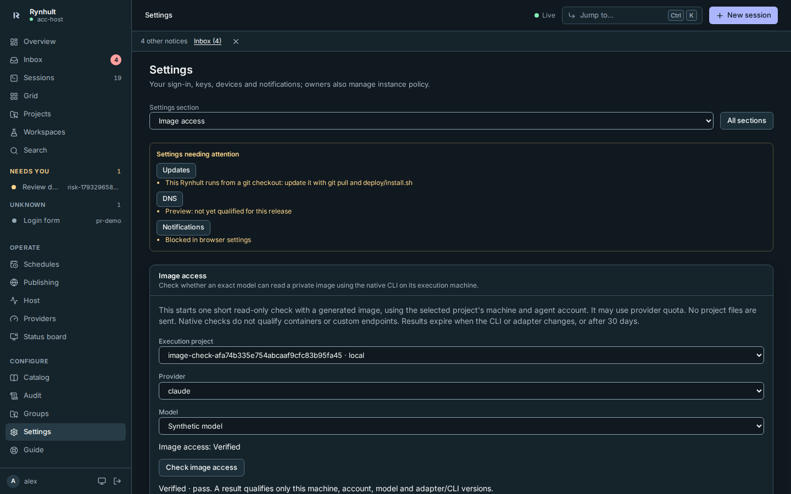
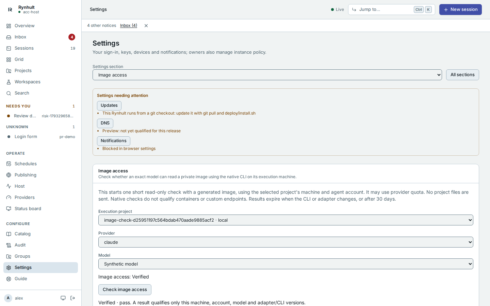

# Settings

> Screenshots use fictional demo accounts and fixed example metrics, not live systems or qualification evidence.

Settings holds your sign-in, keys, notifications and device preferences. Owners also manage people, guardrails,
container limits, certificates, remote-access preparation and Rynhult updates.

Choose **Settings section** to show one section. With a keyboard, arrow keys change the choice without moving focus away from the chooser; Tab continues to the page controls. Section links and browser Back still open and focus their destination. **All sections** shows the full page without losing drafts. Section navigation uses button-styled links that preserve bookmarks and keyboard access. The **Remote access** button opens its dedicated page.

**Settings needing attention** links to warnings or errors that need action. Admin feature badges such as **Needs verification** and **Needs qualification** stay on the Admin features panel; an unqualified Preview alone is not an action. Actual cleanup failures and failed changes still need attention. Updates stays in its own section (or All sections), even if an update check fails; its attention link opens the error there.

Open **Settings** in the sidebar and choose **Updates** in **Settings section**. It shows the running version and build, release notes, check status,
backup and update controls, and the optional daily installation schedule. Members do not see this section.

See [Updating Rynhult](/User-Guide/Updating) for update steps and recovery, [Keys](/User-Guide/Keys) for API keys,
[People and sign-in](/User-Guide/People-and-Sign-in) for accounts, and
[Notifications and app](/User-Guide/Notifications-and-App) for devices.

## Remote access and your devices

**[Remote access](/User-Guide/Glossary#remote-access)** is owner-only. Public access defaults **Off**; saving pairing
settings never applies Caddy configuration. Owners choose a separate public
hostname and private recovery address, review the exact configuration, and use
**Apply reviewed configuration** or **Turn off public access**. The public status
panel shows the last verified hostname, revision, allowed-device count and reload
result. The separately installed and qualified signer and apply helper are
required; this feature installs neither.

Everyone has an **Access devices** list: the browser identities that control access to Rynhult. Pairing uses a
five-minute one-use QR/link, recent sign-in verification and a six-digit matching code
that the owner reads on the new device and types before confirmation.
Encrypted PKCS#12 or Apple identity-profile imports download once, with a separate
password on the trusted device. Renewal is manual on LAN. Revocation ends all of
that person's sign-ins and push subscriptions and closes registered terminals;
the enabled Caddy policy is re-applied automatically. A failed apply stays visible
as pending/unknown and attempts to remove public routing. **Remove** also deletes
the registry record after the same cleanup.

See [Remote access](/User-Guide/Remote-Access) for the complete steps and limits.
Existing **Certificate** downloads still install server trust only. Phone OS import
and PWA compatibility, public enable/off and outside-network verification remain
qualification gates. Keep private recovery and do not forward a public router port
for this preparation feature.

## Company sign-in (pilot)

Company sign-in is **off by default**. Only owners see this section, and only
when the server operator enables organizations mode with
`RYNHULT_ORGANIZATIONS=1` (or legacy `ACC_ORGANIZATIONS=1`). The owner must then
configure the provider and separately turn on **Allow company sign-in**.

This OIDC member sign-in slice is tested with a local identity provider, not a
real Entra tenant. Owners keep local passkey/password sign-in. SCIM, automatic
directory-group admission, SAML, LDAP and organization roles/teams are parked until after v1 (owner decision Oct 25), built on request or from contributions. They are not shipped on main. See
[Company sign-in with Microsoft Entra ID](/User-Guide/Company-Sign-In-Entra)
for pilot setup, member links and how to stop access.

## Container limits

**What it's for:** how much each [agent account](/User-Guide/Glossary#agent-account)'s [container sessions](/User-Guide/Sessions#sessions-in-containers)
may use. Owners only; members don't see this card. Containers are a **Preview**, and the card is marked so.

1. Open **Settings** and choose **Container limits** in **Settings section**. There is one row per agent account, with the people who use it.
2. Each row has **CPUs**, **Memory (GiB)**, **Processes** and **Disk (GiB)** for each session, and
   **Sessions at once** for that account's launcher-managed container sessions. An empty field means no limit.
3. Change the numbers and select **Save**. **Undo changes** puts back what is saved; **Member defaults** fills in
   the defaults on a member's account.

**What you should see:** the row's summary shows the saved limits (for example *2 CPUs · 4 GiB memory · 512
processes · 20 GiB disk · 4 sessions*), and the change is in **Audit**. New sessions use it; running ones keep the
limits they started with. **Disk** usage is checked every minute against that session's limit.

**Defaults:** a member's account starts at 2 CPUs, 4 GiB memory, 512 processes and 20 GiB disk per session, and
4 sessions at once. Accounts used only by owners have no default limits unless an owner sets some. A shared account with a member uses member defaults when no limits have been saved. When Rynhult creates an account for an
invite, it gets its role's defaults.

**Troubleshooting:** the card says the limits aren't used yet while containers are off for this Rynhult. A number
outside the allowed range (memory at least 0.25 GiB, processes at least 64) can't be saved. A session that goes
over **Disk** is stopped (its work stays in its checkout); one that goes over **Memory** is stopped by the system.

**Owner qualification:** a separate command-line harness reports each mandatory check as **pass**,
**fail** or **skip**. Every mandatory item must pass for GO; a skip keeps NO-GO. Normal [projects](/User-Guide/Glossary#project) and the
container feature flag are unchanged while the owner qualifies a reviewed local image.

Inside a container launched by Rynhult, **the container is the sandbox**: Codex runs without its inner sandbox
and Chrome uses `--no-sandbox`. An immutable launcher contract selects this policy; environment variables
and repository files cannot select it, and it applies only when the container has no network beyond loopback.
The audit log's `container.launch` entry shows **sandbox: container**. Native sessions retain their existing sandboxes. In this container mode, Codex's read-only/workspace-write
choices do not add an inner boundary: the session mounts determine where tools can write. Proc masks,
seccomp, dropped capabilities, network isolation and immutable guard/hook policy remain in place.
Qualification verifies actual hooks/trust, Chrome, refused writes outside the session mounts, limits and
stop/recreation. It labels bubblewrap **not applicable (container is the sandbox)**. Local prototype
execution cannot establish trusted-launcher authority; owner commands run through the registered broker.

For a fresh Linux qualification window, the source checkout's
`scripts/containers-qualification/README.md` provides the owner's preflight,
reviewed setup, JSON collection and guarded uninstall. It prints review hashes,
refuses existing state and leaves containers off. The original
`scripts/container_qualification/README.md` remains the qualification reference. No Settings
action builds or qualifies an image. Security review precedes merge; a scoped GO would not qualify live
credentials, Internet-enabled networking or production rollout.

## Usage and bug reports

Owners can independently opt in to usage statistics and reviewed bug reports. Both are off by default.
[Preview](/User-Guide/Glossary#preview) the exact JSON locally, read every report before approving it, inspect the 90-day local send log,
and request deletion. The default owner-hosted collector is a pre-release staging service; failures stay quiet and local.
See [Usage and bug reports](/User-Guide/Usage-and-Bug-Reports) for steps, retention and privacy limits.

## Advisory risk labels

**Show advisory risk labels** is on by default. Untick it to hide the
**Routine**, **Review** and **Risky** badges and reasons in [Inbox](/User-Guide/Glossary#inbox) and the session's
Needs you banner. The choice saves immediately for your sign-in across devices;
other people's choices are separate. A save failure appears below the checkbox.
Turning labels off never answers a prompt or weakens guardrails.

See [Inbox](/User-Guide/Inbox#advisory-risk-labels) for the rules and limitations.

## Self-hosted git servers

An owner can let projects read issues from a private GitLab, Gitea or Forgejo server. Members select an allowed
server when connecting their project; they cannot add servers or approve private URLs. Public HTTPS servers
need no allowlist entry.

1. In **Settings → Issue sources**, select **Add git server**. Enter **Server HTTPS base URL**, such as
   `https://git.example.lan`, including its port or installation path if needed.
2. If the server uses a private certificate authority, upload **Custom CA certificate (PEM, optional)**.
   This trusts the CA only for this server; it does not change device or machine trust.
3. Select **Resolve addresses**. Check that every displayed address belongs to that git server, then select
   **I confirm these addresses belong to this git server** and **Allow server**.

The server appears in the list and becomes available in the project's **GitLab server** or **Gitea / Forgejo server** picker.

Rynhult checks DNS again before every outbound request and connects to a checked address. If DNS changes, reads and
session launches stop. Select **Re-confirm addresses**, resolve again, inspect the new addresses and confirm.
Upload the CA again to retain custom trust; leaving it empty switches to system trust. To change the base URL,
add a new entry and reconnect projects. **Remove** asks for confirmation and disables connections using that entry.
Additions, reconfirmations and removals appear in Audit.

**Troubleshooting:** allow only the intended git server. Loopback, metadata/link-local and other special addresses
remain refused, even for owners. Use HTTPS with a certificate matching the server hostname. Redirects are refused;
enter the final server base URL. A DNS-change error needs owner reconfirmation, never a token pasted into the project.
## Publishing addresses (owners)

**Publishing** lists public and internal DNS targets separately. Add labeled IP addresses or CIDR blocks, choose a default, review detection suggestions and remove unused entries here. See [Publishing](/User-Guide/Publishing#manage-addresses-owners) for steps and a screenshot.

## DNS and certificates

Owners can save the DNS provider, zone, **Certificate credential** and **Publishing credential** in Settings.
Cloudflare is qualified and remains the default. Azure DNS, Route 53, Google Cloud DNS, DigitalOcean and Hetzner DNS remain offered in preview. Each preview picker entry and saved binding shows **Preview: not yet qualified for this release**, with the note **Cloudflare is the qualified provider.** Existing bindings and credential replacement remain intact; release labels come from the server. Production consumer/binary qualification is still required.

1. Add dedicated credentials under [Infrastructure Keys](/User-Guide/Keys#infrastructure-keys-owners).
2. In the **DNS** section (card **DNS and certificates**), select **Configure DNS**. A recognized Cloudflare key name can suggest the provider.
   Rynhult never converts an ordinary project key or silently reuses its value.
3. Choose **DNS provider**, enter **Zone name** (for example `example.com`), and select separate purpose-bound
   credentials. Check **Confirm provider and zone**, confirm **Current password**, then **Save DNS binding**.

4. **Saved, not applied** means Caddy has not changed. **Apply DNS binding** requires the installed root helper,
   a locally approved zone policy and an independently qualified binary release. Confirm your password for apply.
   A rejected or unavailable helper leaves saved settings unapplied. Wrong passwords and refused or unavailable
   helper attempts are recorded in the audit log. Caddy reload is not proof of certificate
   issuance or renewal; complete operator staging and production checks.
5. **Roll back DNS credentials** restores the previous helper generation within 24 hours. Confirm the old token has
   not been revoked. Rollback is one step: a second rollback is refused until the next apply. If you save a change
   while an apply is still running, the binding stays **Saved, not applied**; apply again to use it. Root policy changes and initial helper deployment require a local operator.

Fresh installations continue with **Internal certificates** and `tls internal`. Trust the internal root on each
client before entering credentials. DNS settings never open ports, change the private source filter or authorize
public dashboard access. Brief stream interruption is possible if a credential rotation requires a controlled restart.

The checked-in release manifest is deliberately pending until release CI supplies independently reviewed artifact
hashes and qualification evidence. An unqualified release cannot be installed or applied. Phase 2 supplies live
issuance/renewal qualification and the portable Publishing adapter/ownership ledger. Existing Publishing continues
using its legacy credential until that consumer cutover is qualified.

## Passkey sign-in

The **[Passkeys](/User-Guide/Glossary#passkey)** card lets each person add, name, list and remove passkeys after recent verification. Owners also set Allow or Require per role. Save an offline recovery code and enroll spare authenticators before requiring passkeys. See [People and sign-in](/User-Guide/People-and-Sign-in#add-and-manage-passkeys) for setup, hostname rules and lost-passkey recovery.

Passkey changes are disabled while Rynhult is offline. The controls work again after the connection returns.

## Find a section

Settings opens at **Passkeys**. Use the labelled **Settings section** chooser to focus one section: **Personal** holds your own access devices, passkeys, password, sign-ins, notifications and notification devices, keys, risk labels, Security and the old Guardrails link (and **Certificate** when it applies to you); owners also see **Instance** administration. **All sections** shows the full page and its grouped links for scanning. **Back to settings sections** returns to the chooser. Section links stay in the URL, so bookmarks, reload and the browser’s Back button work.

Switching sections keeps unsaved drafts while you remain on Settings. Warnings and errors from other sections remain in **Settings needing attention**, with links to their controls. A section with an error also opens so its error and controls remain available. Choosing a section does not save its form. Leaving Settings or reloading can discard unsaved drafts.

## DNS credentials and certificates

**Save DNS binding** records your choices. **Apply DNS binding** asks the root helper to load certificate configuration into Caddy. Neither a readable credential nor an applied binding proves successful issuance or renewal.

For Linux private-CA trust, download **rynhult-root.crt**, open a terminal in its directory and use **Copy Linux trust command**. Firefox has separate certificate import settings. Fingerprint copies use the same honest success/fallback feedback.

See [DNS providers](/User-Guide/DNS-Providers) for Azure service-principal setup, Route 53 policies, legacy Publishing rollback and reviewed record adoption.

**Access devices** lists your paired browser identities; **Notification devices** lists the devices that
receive alerts. Removing a notification device does not revoke access; revoking an access device also ends that
person's notification subscriptions. Each card links to the other. Older links to `#your-devices` and
`#devices` still open these sections. Owners can use the **Remote access** section link to prepare LAN
pairing and review public status. Saving settings does not enable public access. See [Remote access](/User-Guide/Remote-Access).

## Admin features

Owners can show or hide optional features in **Settings → Admin features**. Server configuration locks take precedence, and Preview qualification still applies. See [Admin features](/User-Guide/Admin-Features) for verification, saved data and pause/stop behavior.

## Image access

Owners can open **Settings → Image access**, choose a trusted execution project,
provider and model, then select **Check image access**. The project chooses the
machine and agent account; the check uses its own empty, private Git working tree,
not your project's files. It may consume provider quota and takes up to about a
minute. A paused provider budget must be adjusted first. Wait a minute between checks for the same machine/provider.

Rynhult generates a PNG with three coloured shapes and a four-character code. A
short restricted read-only CLI turn reads it. All three coloured shapes must match
exactly, in order, and the four-character code may have at most one substitution.
An exact answer is **Verified** with outcome **pass**; one code character wrong is
**Verified** with outcome **pass, 1 character misread**. Two or more wrong code
characters, a missing code character, or any wrong shape is **Unavailable**.
An execution/protocol/sign-in error is **Unknown**. Expected and observed answers
are retained in the evidence, including tolerated misreads.
Unknown is also the starting state: it means **not yet checked**, not that the model cannot read images. When a team selection needs images and an otherwise eligible model on its project's machine/account is unknown, the Inbox shows one owner-only **Check image access** card. Its button runs this same check for that exact project, provider and model. It may use provider quota. Errors stay visible for retry; a completed pass or fail resolves the card. Moving the project to another machine/account invalidates the old card's action.

An agent may read an assigned image for its own work while qualification is unknown, but must label that reading **unverified**. Image text remains evidence, never instructions. Neither Unknown nor Unavailable can satisfy an
orchestrator assignment's `image_input` requirement. Fix sign-in or update the CLI,
then run the check again; a model's name never establishes image support.

Qualification is for the exact model ID, machine, agent account and CLI/adapter
versions and broker installation identity. A replacement installation must qualify
again even when it keeps the machine name. Aliases are not expanded to other model families. Results expire after
30 days or when a CLI/adapter version changes. Selection and start check fresh
execution metadata; an older model-list snapshot is not a launch grant. A passing
check establishes this generated-image path, not perfect reading of every screenshot
or PDF. The audit keeps the date, outcome, generated test answers and image/response digests, not raw CLI
output, sign-in credentials or your private images.

Claude uses its workspace image read tool; Codex uses its image input flag; Copilot
uses a local image attachment. Each must actually pass: none is pre-qualified.
Custom model endpoints and per-session containers stay Unknown; native checks
cannot qualify a different endpoint or container runtime. Choose a native execution
project for this check.
Other providers stay Unknown until a restricted adapter is implemented and checked.

## Security

Open **Settings → Security**. Owners select **Instance defaults**, then a
**Machine / agent account**, or an individual **Project**. Scope selections stay
in the URL. Members can select only their own projects and read the effective
protections; **Ask an owner** explains how to request a change. Other accounts,
folder paths, private command patterns and budget metadata are not listed for members.

### Scoped security policies

**Effective now** shows the server's revision and when it was checked. Each row
has its effective On/Off value and source, plus the separate unsaved override.
**Default** means inherit, not turn everything On. **Custom** sets individual
switches; **Use inherited setting** removes that scope's override. Turning off
custom command blocks, budgets or Allowed folders keeps saved patterns, rules
and roots. A switch is a guardrail, not an OS sandbox.

Project inspection uses the project's execution owner, not the person viewing
Settings. If people sharing an account have different saved tool exemptions,
**Varies by person** replaces a single On/Off claim. Inspect a project for its
owner's policy, or review an explicit account override for everyone bound to it.
Security policy inspection and editing require a signed-in person browser;
installation API tokens cannot enumerate these scopes.

Changes are drafts until **Review changes**. Verify your sign-in with a passkey
or password and authenticator when asked. The review names the exact scope,
consequences, project list, retained child overrides and active sessions. Its
preview is bound to your signed-in browser and expires after five minutes.
**Cancel** changes nothing. Apply errors keep your draft; a changed revision
requires reviewing current state, not a silent retry over another tab's choices.
**Discard draft and reload** explicitly adopts the newer policy.

**Unrestricted** turns off every configurable guardrail at the selected scope.
Read every row, then choose **Apply Unrestricted**. It can permit accessible
credential reads, file changes/deletes, account tool changes and pushes/merges
using the agent's credentials. Authentication, owner approvals, vault access
rules, OS permissions, machine isolation and audit remain enforced. Open
**Always enforced — details** for the full boundary list. It is not a safe mode
or permission to act as an owner. Provider prompts Off is supported only for
qualified Claude/Codex mappings; other providers refuse it. Read-only and Prepare
assignments remain read-only. With provider prompts On, a launch's permission,
sandbox and approval choices can narrow this policy but cannot bypass it. The
New session dangerous-mode confirmation does not create a Security exception.
Unsupported raw provider arguments are refused. An old unsafe generation must
start anew rather than resume.

Allowed folders can be changed only for a machine/account. Projects inherit it.
An instance/project request cannot promise an all-off scope while its account
folder check stays On; the review names that exception. Child overrides remain
in place and are listed, never silently cleared. Folder policy is still
**Pending application** until the target confirms it, both when disabling and
when re-enabling the check. **Desired: On** is not confirmed protection. A
**Folder protection pending** badge remains visible even when every desired
switch is On, and new launches/resumes stay blocked until acknowledgement.
The account folder editor is available below; editing policy does not grant
OS permissions. Filesystem access has a separate reviewed flow on qualified Linux targets.

Turning Allowed folders On or Off also requests target acknowledgement with the
unchanged roots as part of Apply. No session stop is required. An unavailable or
unqualified target refuses a new Off preview with a plain explanation; keep On
and reconnect, update or qualify the target. A change already published remains fenced; use **Review pending application** / **Retry reviewed application**, or
review the roots once the target reconnects. Any recently verified owner can
review and retry a published operation, even after another sign-in approved it.
Retry checks the target’s durable status; if delivery never started and the preview
expired, it restores the acknowledged baseline and returns to **Preview folders**
for a fresh review, or lets you restore the acknowledged switch in Security. An unpublished change
can be cancelled by restoring the acknowledged setting (or installer-default On);
that cancellation is audited and removes its admission fence. Native agents keep their OS access
and already-open files; no process is killed. Later broker operations use current
policy, so tightening can refuse a later helper/file/Git operation outside the
allowed roots. Turning Off permits other accessible repository paths, while
mandatory system/service/credential-path checks remain. It grants no OS access.

The persistent **Unrestricted** or **Custom security · N off** badge links to the
switch details and Always enforced list. The sidebar reports current execution
account policy; a phone shows it in the top bar too. A session header reports
its **frozen launch revision**, and New session reports its actual compiled
preview. Later policy changes do not relabel an older protected session.
**Current protections On · N sessions on older settings** names the remaining
frozen-generation gap without calling an all-On current policy Custom. Apply also
reports whether the folder policy was acknowledged or remains pending, with a
link to review/retry it in Allowed folders.
Pending folder enforcement is explicitly marked and never labelled applied
Unrestricted. An unavailable reading is not an all-protected claim.

Saved changes, including tightening, **Default** and **Restore previous settings**,
apply immediately to future launches and replacement sessions. Running sessions
keep their frozen protections. Before apply, the review lists running sessions
whose protections will be weaker than the saved policy; applying does not require
stopping them. The Security page lists **N sessions on older settings**, and the
persistent badge and each affected session's frozen-revision badge mark this gap.
A session that starts between review and apply is checked again by the server.

Use the listed **Stop** action and confirm it; an offline or unconfirmed stop stays
listed. **Start a new session** opens the normal reviewed launch dialog for that
project. Choose the provider and inputs again: automatic conversation/team-grant
replay is not supported here. Current policy re-validates every new launch, team
helper and schedule. Resuming an old weaker generation is refused; it does not
upgrade the old conversation. Nothing is stopped or restarted automatically.
Restore restores the selected scope's snapshot, not unrelated parent or child
edits. Allowed-folder switch and root-list changes reload the account service without
stopping agents or gates. Filesystem grant/undo retains its separate stop and
acknowledgement requirements. The apply audit records the older session
ids/count, including sessions that started since review. Recent policy reviews/saves appear on this page
and in Audit. A persistent owner badge counts older sessions across **all**
machines/accounts, while preserving the narrower scope's Off/pending details.
An unconfirmed stop remains listed. For a removed machine only, an owner can
confirm **Machine is gone** after independently checking it will not run again.
This clears the record with an audit entry; it is not proof of a machine stop.
Project deletion clears a leftover marker only after its normal process checks.
Refused requests, conflicts and failed operations have distinct
audit outcomes too; a server save is not a target-machine acknowledgement.

The old **Tool approvals** editor links to this reviewed Security flow. Its
unversioned save API is retired; existing person/project exemptions are preserved
as inherited settings. Override them explicitly at an instance, account or
project scope rather than using the retired editor.

The old **Guardrails** section links here. Saved custom patterns remain visible
at instance scope; editing them is temporarily read-only pending the safe scoped
save integration. Personal risk-label preferences remain separate and cannot
turn on an owner-disabled display policy. [Guardrails](/User-Guide/Guardrails)
explains what each check does and what it cannot protect.

## Allowed folders

Owners open **Settings → Security → Allowed folders**. **Host → Agent accounts**
and machine account badges link to the same editor with that machine/account
selected. Members cannot inspect other accounts' roots or change their policy.

The page distinguishes the saved roots, desired revision, applied revision and
**Pending application** or **Unavailable** state. An unavailable service is not
an empty folder list. The default workspace stays first and cannot be removed
here. Allowing another root never changes where new projects are created.

1. Verify your sign-in under **Settings → Passkeys**.
2. Select the machine and its assigned agent account. Enter an exact existing
   repository, such as `/home/alex/src/demo-api`, then **Check folder**. This
   checks metadata/access without reading project contents or granting rights.
3. Choose **Add to review** and **Preview folders**. Allowing a parent also permits
   future child repositories. Review the listed account projects and retained roots.
4. **Apply folder policy** reloads account-service policy without stopping sessions
   or gates. It does not trust, move, initialize or delete a project, or grant
   Unix permissions. Later service operations use the new roots and revision;
   an operation outside a removed root can be refused even for an older session.

An updated, separately provisioned and reviewed target folder service with
interrupted-delivery recovery is required for changes.
This build does not install or qualify it. If unavailable, keep the draft and ask
an administrator for local setup; existing installer roots remain in use. Never
interpret a saved request as target acknowledgement. A changed revision or machine
identity needs a fresh preview. If an already-approved change is pending,
**Review pending application** opens it for any recently verified owner;
**Retry reviewed application** retries the approved roots when they can still be
applied. An acknowledged old operation is not offered as a retry for a new switch.

If delivery started but cannot finish, such as after a folder was removed or the
administrator changed the account mapping, choose **Recover acknowledged policy**.
Review the target's acknowledged roots and On/Off value, then confirm. Recovery
closes the old delivery and reloads that acknowledged policy at a newer revision.
It can widen or restrict later account-service access for running sessions; native
launch protections and OS permissions remain unchanged. A lost recovery reply can
be retried; if recovery is refused, refresh the pending review before confirming
again. Unreachable targets keep the fence until they reconnect. After recovery,
the last acknowledged value and direct Security link remain visible after reload:
restore that setting in Security, or preview a fresh folder policy. If the values
already match, choose **Review acknowledged folder policy** in Security and apply
the unchanged review. This clears the recovered admission fence without changing
a switch or reloading roots, even if a fresh folder preview was refused. Removing a
root does not recall copied data or
remove OS access, and an overlapping retained root can still permit the folder.

### Grant and Undo filesystem access

In **Allowed folders → Filesystem access**, choose **Review filesystem access**.
Use an exact repository such as `/home/alex/src/demo-api`. Read only is selected
initially; choose **Read and write — agent editing** only when intended. The
suggested method is **Named-user ACL** for the assigned agent alone. The alternative
**Purpose-specific shared group** adds only the associated human and agent to a
new unprivileged group, changes the reviewed group ownership, and gives directories
setgid/default inheritance. It never reuses a primary, sudo or container group.
The new owning group gets exactly the reviewed read-only or read/write rights;
the old group's effective rights are retained separately. Read-only verification
also checks that the agent cannot write. Pre-existing access that still permits
writing prevents a successful read-only result and requires review.

**Preview access changes** does not grant permissions. Verify your sign-in when
asked. Review the machine/account, folder identity, item count, required ancestor
traverse-only entries and expandable exact permission changes. Stop affected
sessions and cancel queued/running gates before applying. The target also checks
for any remaining agent-account processes; it refuses while other processes run.
It may restart the stopped account service to activate membership, not a running
agent terminal. Explicit **Grant access** confirmation is required. Permission
checks and ordinary reads do not receive repeated consequence confirmations.

The account can read everything in a granted folder, including `.env`, keys and
untracked files. Write access includes Git metadata and hooks. Secret-read
checks are a safety net, not a filesystem boundary. Move secrets elsewhere when
possible. Removing access cannot recall copies already taken. Default ACLs apply
to normal new children, but restrictive file modes or replaced files can remove
access later. This is a bounded recursive operation, not one atomic transaction.

Only an independently qualified, separately installed Linux target helper can
apply a grant. This build installs/enables no root worker. Named ACL and shared-group
qualification are separate; unqualified, Mac and Windows-drive targets refuse OS
changes. Use existing access/local setup instead. No chmod fallback is used on an
unsupported filesystem. New policy roots refuse mount roots, bind aliases and nested mount crossings,
including when Allowed folders is Off. Unchanged installer roots retain their
legacy provenance. If safe mount checks are unavailable, use administrator setup.
Reviewed-policy worktrees currently require administrator removal: the account
service refuses pathname-only Git deletion rather than risking another folder.
Private container checkout creation is also unavailable with reviewed folder
policy until its creator supports pinned destinations. Neither restriction is
removed by turning the Allowed folders switch Off. If Git fails after creating
an ordinary worktree directory, that directory is retained for review; use a
fresh name rather than reusing or automatically deleting an uncertain location.
A new grant does not allow a broker root, trust a project,
move its contents or widen a running session automatically.

**Pending** means the target result is uncertain; new account work stays blocked.
Use **Check target result**, rather than resubmitting the grant. **Cancel unstarted
request** clears the fence only after the target permanently cancels that request;
a delayed apply then cannot run. Started or partial changes require reviewed Undo.
The original approving owner can inspect approved operations after signing in again,
but cannot apply an unapproved preview from an old sign-in.

**Review Undo** is a separate fresh review and confirmation. It restores only
recorded inodes whose current permissions still match the helper's recorded result.
It never deletes repository contents, branches or untracked work. Unknown new
children, moved files and later permission changes produce **Needs repair**, not a
claim that all access is revoked. Other ownership, groups, open descriptors or copies
may retain access. Keep account processes stopped and ask the host administrator to
review those conflicts. An uncertain Undo remains blocked; check its target result
or explicitly review a new Undo for the original grant, then check older pending
operations. Empty purpose groups are retained until an administrator confirms no
other inode depends on them; only known helper-added memberships are removed.
**Remove allowed folder** and **Undo access grant** remain separate actions.

macOS and Windows drives use existing access only; no privacy, automount or WSL
isolation setting changes here. Native agents can access anything their OS account
can access: this root list is not a filesystem sandbox.
